← <a href="index.html">Torna alla parte generale</a> · Guide da terminale: <a href="claude-code.html">Claude Code</a> · <a href="codex.html">Codex</a>

Le guide a <a href="claude-code.html">Claude Code</a> e a <a href="codex.html">Codex</a> usano il terminale. Non è l'unica strada. Entrambi gli agenti esistono anche come **app desktop**, che fanno lo stesso lavoro **in locale**: si sceglie una cartella del computer, e l'agente legge i file, scrive ed esegue codice (R, Python, Quarto, Git...), usa le vostre skill e i file di istruzioni del progetto (`CLAUDE.md`, `AGENTS.md`), si collega ai connettori. La superpotenza è la stessa; cambia l'interfaccia.

Questa guida mostra le due app su **Windows**, a ottobre 2026: l'app **Claude** (versione 2.42304, scheda *Code*) e l'app **ChatGPT** nella sezione **Codex** (versione 26.1007, con account ChatGPT Edu). La cartella di prova e le richieste sono le stesse delle guide da terminale, così il confronto è diretto. Il dataset e la regressione sono un esempio giocattolo **inventato da Claude**, di sua iniziativa: dati simulati, senza alcun legame con ricerche o dati reali, miei o di altri (vedi la <a href="index.html#un-esempio-concreto-stesso-compito-due-agenti">nota nella parte generale</a>).

### Obiettivi della guida

- Capire quando conviene l'app e quando il terminale.
- Aprire una cartella di lavoro e dare la prima richiesta.
- Trovare nei menu le stesse cose delle guide da terminale: modello, *effort*, permessi, *plan*.
- Usare quello che le app aggiungono: pannelli per modifiche, file, terminale e browser.

## Terminale o app?

Io preferisco il terminale, per un motivo semplice. Non apro l'app dell'AI chiedendomi "oggi cosa facciamo con l'AI?". Lavoro normalmente, sulle mie cartelle e sui miei file; quando mi accorgo che lì sarebbe utile un agente, apro il terminale in quella cartella (tasto destro → *Apri nel terminale*), scrivo `claude` o `codex`, e lui parte da dove sono io. L'agente entra nel mio lavoro, non il contrario.

Con le app il flusso è rovesciato: si apre l'app e **ogni volta bisogna indicarle la cartella** su cui lavorare. In Codex, poi, la cartella diventa un **progetto** dell'app, da creare e dare un nome prima di cominciare. Non è un dramma, ma per me è meno fluido.

Detto questo, le app hanno dei vantaggi veri:

- **niente terminale**: per chi non si trova a suo agio con la riga di comando, è l'ostacolo che sparisce;
- **menu al posto dei comandi**: modello, *effort*, permessi e modalità *plan* si scelgono con un clic, senza ricordare `/model` o `Shift+Tab`;
- **pannelli laterali**: le modifiche ai file (riga per riga, con i colori), l'albero dei file, un terminale vero e un **browser integrato**, tutti accanto alla conversazione;
- **sessioni in ordine**: le conversazioni passate restano nella barra laterale, raggruppate per cartella o progetto, e si riprendono con un clic;
- piccole comodità: commentare un piano selezionandone una parte, rispondere alle domande dell'agente con dei pulsanti, annullare un'intera modifica con *Undo*.

Le due strade non si escludono. La cartella è la stessa, i file sono gli stessi, le skill e i file di istruzioni pure: si può lavorare da terminale un giorno e dall'app il giorno dopo.

| Cosa | Da terminale | Nell'app Claude | Nell'app Codex |
|---|---|---|---|
| Cartella di lavoro | si apre il terminale lì | *Scegli...* → *Apri cartella...* | si crea un **progetto** con la cartella |
| Modello ed *effort* | `/model`, `/effort` | menu in basso a destra | menu in basso a destra |
| Permessi e modalità | `Shift+Tab`, `/permissions` | menu *Auto* in basso | menu *Approve for me* in basso |
| Piano prima di agire | modalità *plan* | modalità *Piano* | **+** → *Plan mode* |
| Vedere le modifiche | diff nel terminale | pannello *Modifiche* | *View changes* |
| Riprendere una sessione | `claude -c`, `codex resume` | barra laterale | barra laterale |

## Installazione

**Claude.** Si scarica l'app da <a href="https://claude.com/download" target="_blank">claude.com/download</a> (Windows e macOS) e si fa il login con il proprio account. In alto a sinistra ci sono due icone: la chat e **Code** (`</>`). Gli agenti sono in *Code*. Valgono gli stessi requisiti di Claude Code da terminale: serve almeno il piano **Pro** (vedi la <a href="index.html">parte generale</a> sui costi).

**Codex.** L'app si trova sulla pagina ufficiale di <a href="https://chatgpt.com/codex" target="_blank">Codex</a> e, su Windows, nel Microsoft Store. Nella mia installazione il pacchetto si chiama *Codex* ma la finestra si presenta come **ChatGPT**, con **Codex** selezionato in alto a sinistra. Il login è quello di ChatGPT (qui un account Edu). Requisiti e limiti di utilizzo sono gli stessi di Codex da terminale.

## Claude: la scheda Code

#### Scegliere la cartella

In basso, sotto la casella di testo, ci sono tre indicazioni: dove lavora l'agente (*Questo computer*, cioè in locale), su quale cartella, e in che modalità. Si clicca su *Scegli...* → *Apri cartella...* e si seleziona la cartella del progetto:

<figure>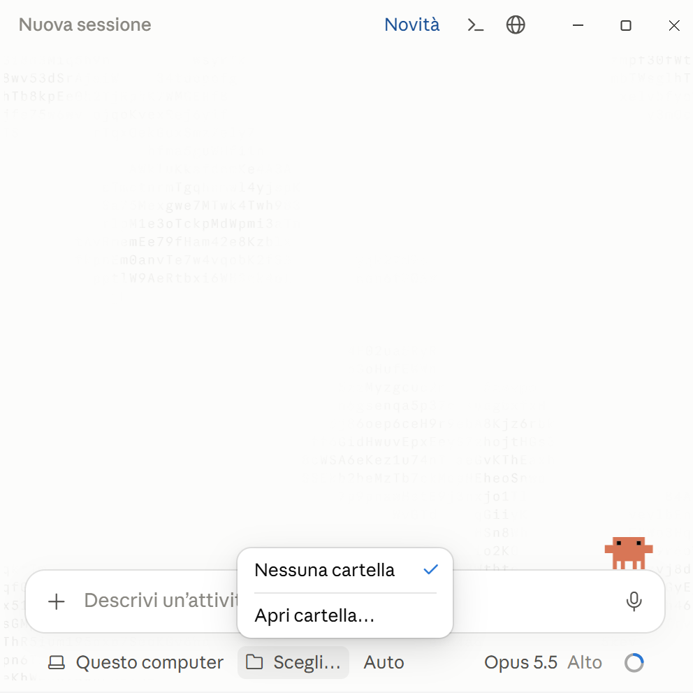<figcaption>La prima cosa da fare in ogni nuova sessione: scegliere la cartella di lavoro</figcaption></figure>

#### La prima richiesta

Stessa richiesta delle guide da terminale:

> *In questa cartella c'è dati_esame.csv. Dai un'occhiata ai dati, poi scrivi uno script R chiamato analisi.R che stima una regressione del voto su ore_studio, ansia e gruppo, eseguilo e spiegami i risultati in poche righe.*

<figure>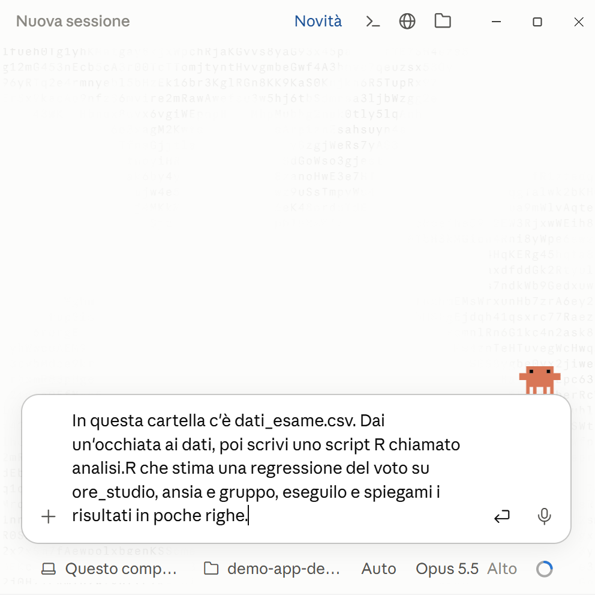<figcaption>La richiesta pronta: sotto la casella, cartella (`demo-app-desktop`), modalità (*Auto*), modello ed effort (*Opus 5.5 Alto*)</figcaption></figure>

Mentre lavora, Claude mostra la lista dei passi che si è dato e i comandi che sta eseguendo. La sessione compare nella barra laterale, sotto il nome della cartella:

<figure>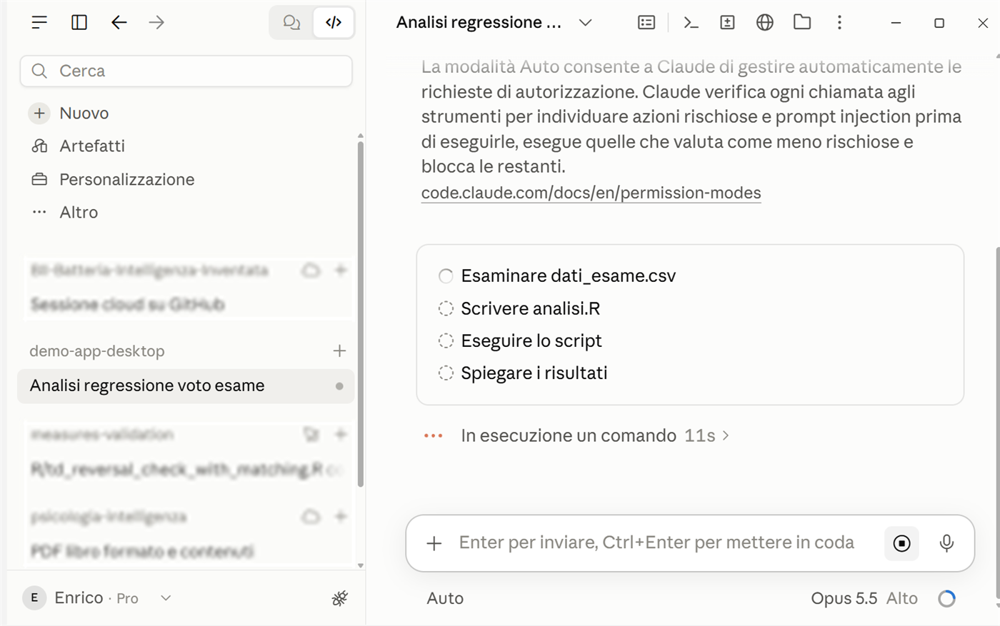<figcaption>Claude al lavoro: a destra la lista dei passi, a sinistra le sessioni raggruppate per cartella (i titoli delle altre sessioni sono sfocati)</figcaption></figure>

Il risultato è quello che si ottiene da terminale: `analisi.R` creato ed eseguito, risultati spiegati in poche righe. Stavolta Claude ha notato da solo un'altra particolarità dei dati simulati, il **pavimento a 18** (molti voti esattamente al minimo), e ha aggiunto allo script un modello tobit come controllo. È un buon esempio del fatto che lo stesso agente, sulla stessa richiesta, non fa sempre le stesse scelte: ragione in più per leggere quello che produce.

#### Modalità, modello, effort

Le modalità sono le stesse del terminale. Al posto di `Shift+Tab` c'è un menu:

<figure>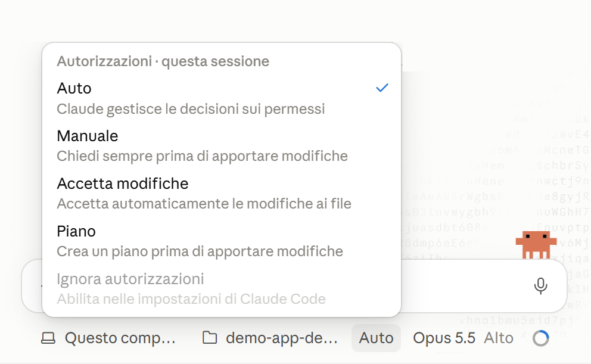<figcaption>*Auto*, *Manuale*, *Accetta modifiche* e *Piano*, come da terminale (vedi la <a href="claude-code.html#le-modalità-di-lavoro">guida a Claude Code</a>)</figcaption></figure>

Il modello e l'*effort* (qui *Impegno*) si scelgono dal menu accanto:

<figure>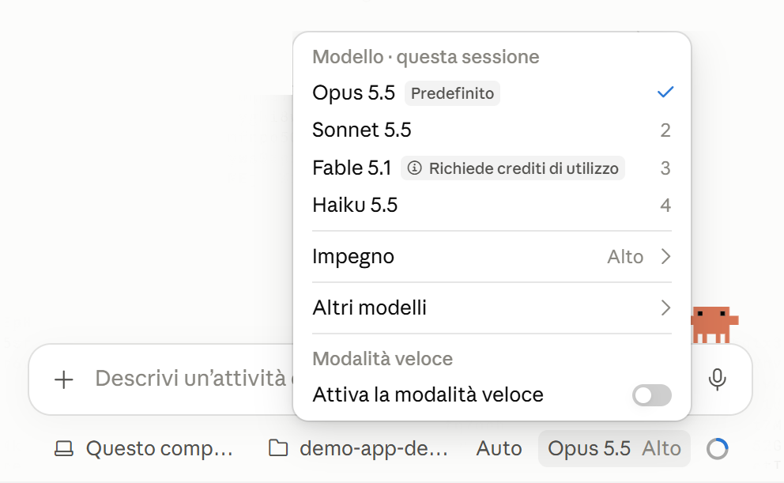<figcaption>Opus (predefinito), Sonnet, Fable e Haiku; sotto, l'*Impegno* (effort) e la modalità veloce. Con il piano Pro, Fable richiede crediti di utilizzo aggiuntivi</figcaption></figure>

La casella di testo accetta anche i comandi che iniziano con `/` (lo dice lei stessa: *Digita / per i comandi*): chi viene dal terminale ritrova le sue abitudini.

#### I pannelli: dove l'app dà qualcosa in più

In alto a destra ci sono alcune icone che aprono pannelli accanto alla conversazione. Il primo riassume la **sessione**: su quale computer e cartella si lavora, il *branch* Git, quanto contesto è occupato, quanti connettori sono attivi, e quante righe sono state modificate, con un pulsante per fare il commit:

<figure>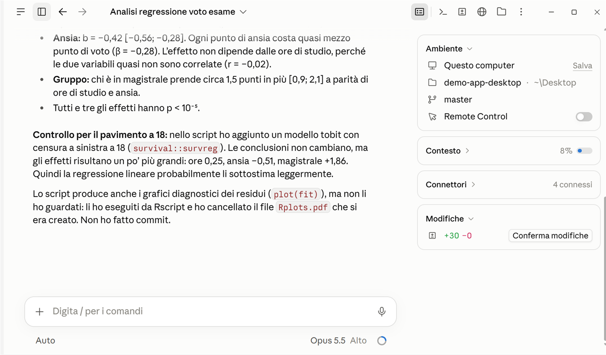<figcaption>Il pannello della sessione: ambiente, contesto, connettori, modifiche (*+30 −0*) e *Conferma modifiche*</figcaption></figure>

Il pannello delle **modifiche** mostra riga per riga cosa è cambiato nei file. È la cosa che da terminale si legge peggio, e che qui si legge meglio:

<figure>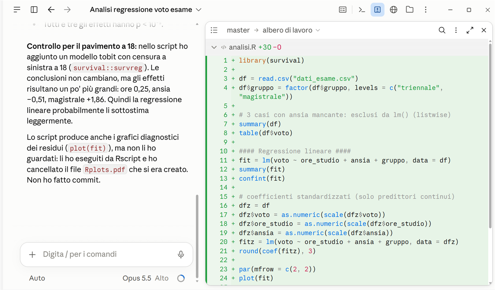<figcaption>Le modifiche ad `analisi.R`, con le righe aggiunte in verde</figcaption></figure>

Si possono aprire più pannelli insieme, ad esempio modifiche, albero dei file e un **terminale** già posizionato nella cartella di lavoro, dove lanciare i propri comandi:

<figure>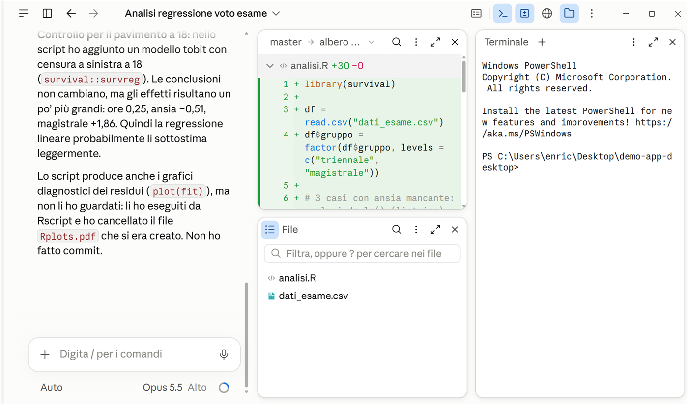<figcaption>Conversazione, modifiche, file e terminale nella stessa finestra</figcaption></figure>

C'è anche un pannello con un **browser integrato**, che Claude usa da solo per controllare quello che produce (pagine HTML, siti, app), come si vede più sotto.

#### Il piano

Ho chiesto, in modalità *Piano*, la stessa trasformazione in report Quarto delle guide da terminale. Il piano compare in un pannello a parte, e si può **commentare selezionandone una parte**, come in un documento condiviso. Sotto, i pulsanti per rifiutarlo, chiederne una revisione o accettarlo (con approvazione manuale o in modalità automatica):

<figure>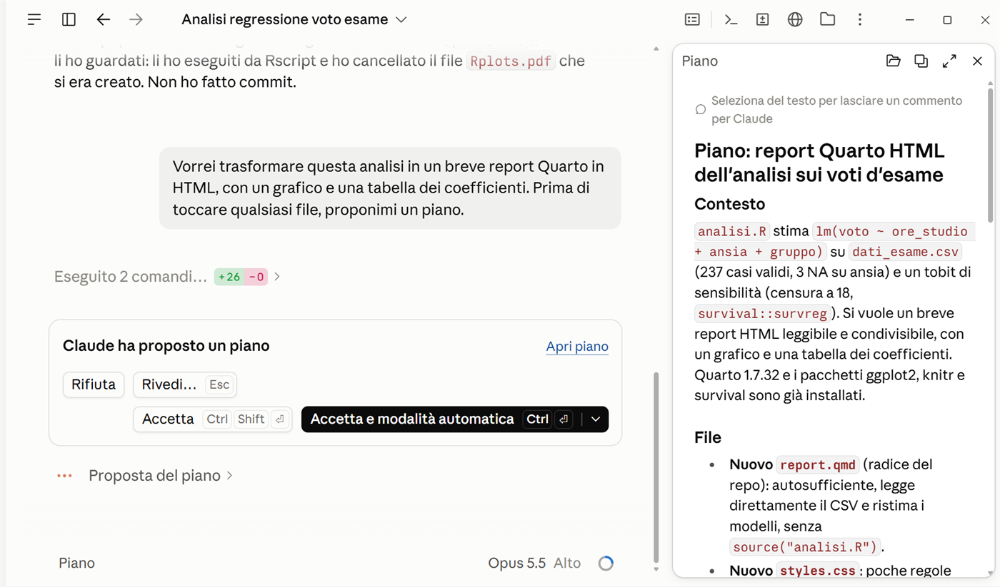<figcaption>Il piano proposto, a destra, e le scelte per procedere, a sinistra</figcaption></figure>

Approvato il piano, Claude ha scritto il report, lo ha renderizzato e lo ha **controllato nel browser integrato**, anche a larghezza da cellulare, correggendo un paio di dettagli di impaginazione. Alla fine chiede se fare il commit, con dei pulsanti al posto di un "sì" da scrivere:

<figure>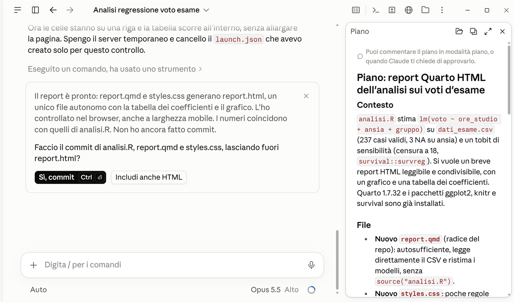<figcaption>Report pronto e verificato; la domanda sul commit si risponde con un clic</figcaption></figure>

## Codex: l'app ChatGPT

#### Creare un progetto

In Codex non si sceglie semplicemente una cartella: si lavora dentro un **progetto**. Dal menu dei progetti, sopra la casella di testo, si sceglie un progetto esistente oppure *New project*:

<figure>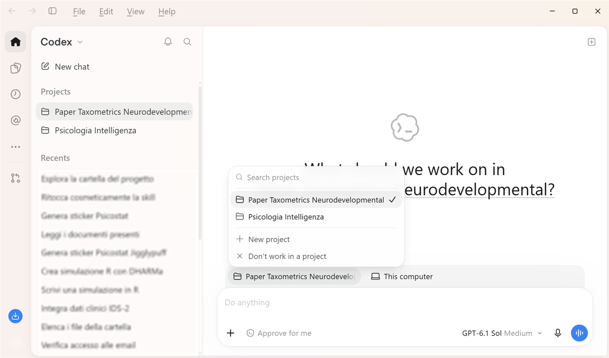<figcaption>Il menu dei progetti: quelli esistenti, *New project* o *Don't work in a project* (le chat recenti sono sfocate)</figcaption></figure>

*New project* chiede un nome e una o più cartelle (*Source folders* → *Add*). Fatto questo, il progetto resta nella barra laterale e le sue chat si raccolgono lì sotto. Comodo per ritrovare le cose, ma è un passaggio in più rispetto ad aprire il terminale nella cartella.

#### La prima richiesta

Stessa richiesta (con lo script chiamato `analisi_codex.R`, perché nella cartella c'era già quello di Claude). Codex ha esplorato i dati, scritto ed eseguito lo script, e riassunto i risultati, uguali a quelli ottenuti da terminale. In fondo, un riquadro riassume le modifiche ai file, con *Undo* per annullarle in blocco e *View changes* per vederle:

<figure>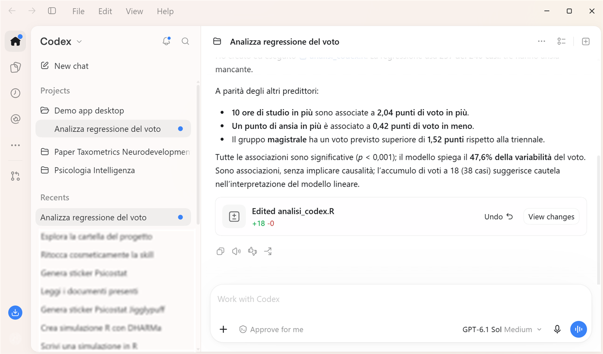<figcaption>Il progetto *Demo app desktop* nella barra laterale, il risultato, e il riquadro *Edited analisi_codex.R*</figcaption></figure>

<figure>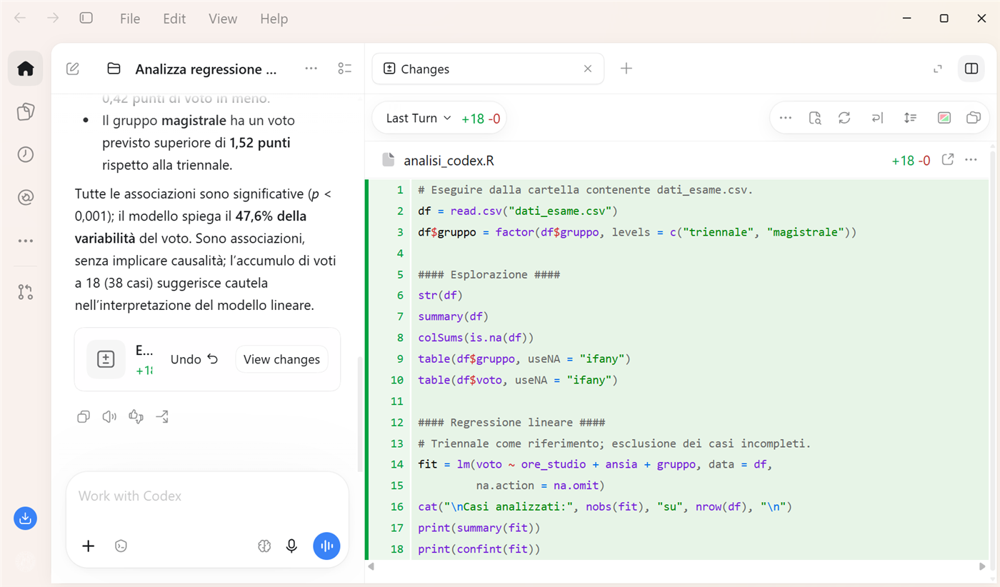<figcaption>*View changes* apre le modifiche in un pannello laterale (qui con la barra dei progetti nascosta)</figcaption></figure>

#### Pannelli e browser integrato

Il **+** in cima al pannello laterale apre una nuova scheda: un **browser integrato** e, sotto, gli strumenti: *Terminal*, *Files* e *Side chat* (una conversazione parallela, a lato di quella principale):

<figure>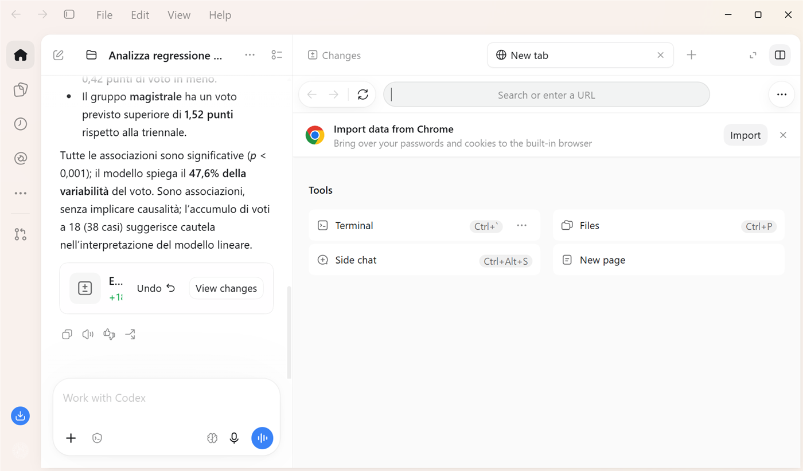<figcaption>Una nuova scheda del pannello: barra degli indirizzi del browser integrato e strumenti</figcaption></figure>

#### Permessi, modello, ragionamento

I permessi si scelgono dal menu in basso. Nell'app i livelli sono tre: *Ask for approval*, *Approve for me* e *Full access* (vedi la <a href="codex.html#permessi">guida a Codex</a> per il significato):

<figure>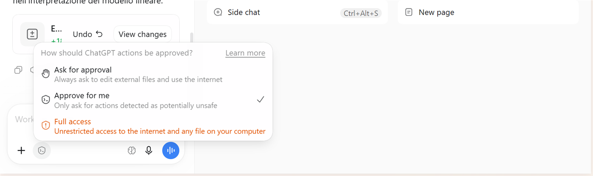<figcaption>I livelli di permesso nell'app Codex</figcaption></figure>

Il menu del modello mostra un **cursore per il livello di ragionamento**; cliccando sul nome del modello si cambia modello:

<figure>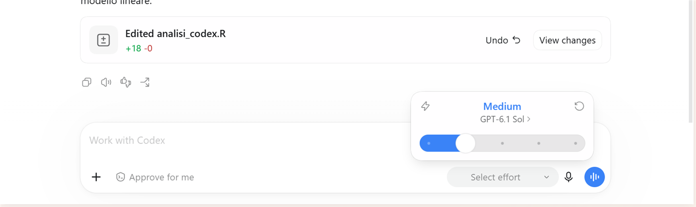<figcaption>Livello di ragionamento *Medium* con GPT-6.1 Sol</figcaption></figure>

Il **+** a sinistra nella casella di testo raccoglie il resto: allegare file e cartelle (o persino una finestra aperta, come il terminale), fissare un obiettivo da perseguire (*Goal*), attivare la **Plan mode**, disegnare uno schizzo, e usare i **plugin** (Google Calendar, Gmail, GitHub, ecc., secondo quello che il vostro account consente):

<figure>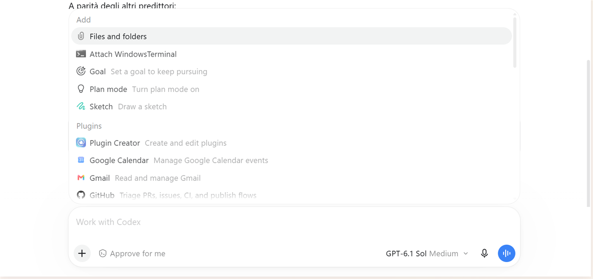<figcaption>Il menu **+**: allegati, *Goal*, *Plan mode*, *Sketch* e plugin</figcaption></figure>

#### Plan mode

Dal **+** → *Plan mode*, la stessa richiesta del report Quarto. Come da terminale, Codex ha letto da solo la mia skill sui report (`reporting-style-enrico`, vedi il <a href="../skills/index.html">post sulle skill</a>) e poi mi ha fatto una domanda, a cui si risponde con un clic:

<figure>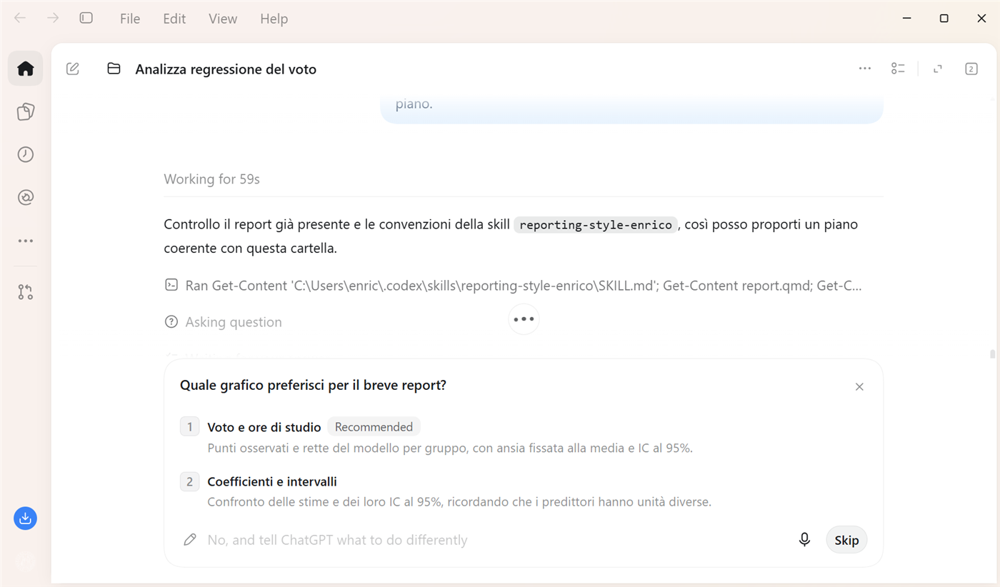<figcaption>Prima la skill (riga *Ran Get-Content ... SKILL.md*), poi la domanda sul grafico, con l'opzione consigliata</figcaption></figure>

<figure>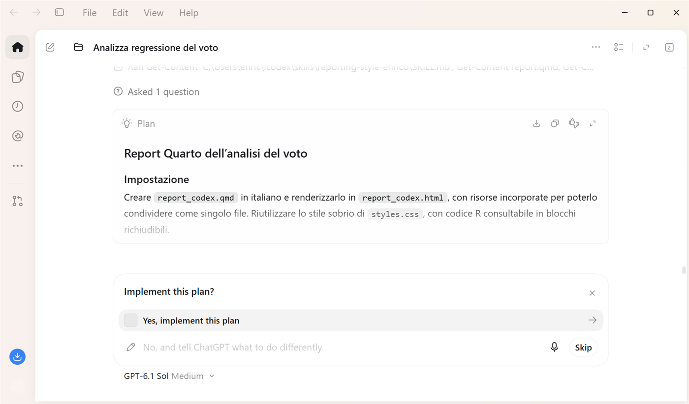<figcaption>Il piano e la richiesta di conferma: *Yes, implement this plan*, oppure indicare cosa cambiare</figcaption></figure>

Approvato il piano, in un minuto e mezzo Codex ha creato e renderizzato `report_codex.qmd`. Ha segnalato di non essere riuscito ad aprire il file locale nel browser integrato per controllarlo; aprirlo a mano funziona, scrivendone il percorso nella barra degli indirizzi. Il report si legge così accanto alla conversazione:

<figure>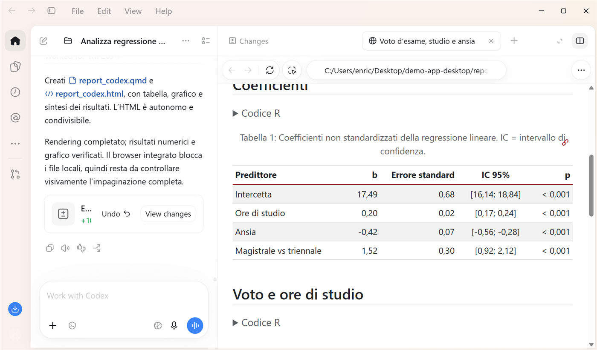<figcaption>Il report di Codex nel browser integrato, accanto alla chat</figcaption></figure>

Il browser integrato ha anche una modalità di annotazione, per lasciare a Codex commenti visivi su una pagina (un clic o un'area selezionata): utile quando si lavora su siti o app.

## In sintesi

- Le app desktop di Claude e Codex fanno lo **stesso lavoro in locale** degli agenti da terminale: stessi modelli, stesse modalità, stesse skill, stessi file di istruzioni.
- Cambia il punto di partenza: **dal terminale** l'agente si chiama nella cartella in cui si sta già lavorando; **dall'app** si sceglie ogni volta la cartella (in Codex, un progetto).
- In cambio le app offrono **menu al posto dei comandi** e **pannelli** per modifiche, file, terminale e browser: per chi non ama il terminale, o per rivedere bene le modifiche, sono un'ottima porta d'ingresso.
- Le precauzioni della <a href="index.html#precauzioni">parte generale</a> valgono uguali: Git, dati sensibili, autonomia graduale, responsabilità.

---

← <a href="index.html">Torna alla parte generale</a> · Guide da terminale: <a href="claude-code.html">Claude Code</a> · <a href="codex.html">Codex</a>

::: {.callout-note appearance="simple" icon="false"}
**Chi ha scritto questo post.** Di fatto, l'ha scritto **Claude** (Anthropic), lavorando come agente in Claude Code da terminale, e ha prodotto anche le schermate, pilotando da sé le due app desktop (per una parte dei passaggi in Codex ho dovuto autorizzare esplicitamente ogni singola azione, perché i controlli di sicurezza di Claude Code la bloccavano). Io ho fornito i materiali, l'esperienza e le indicazioni, e ho supervisionato e rivisto il risultato. La prima persona nel testo resta la mia, perché esperienze e opinioni sono mie.
:::
