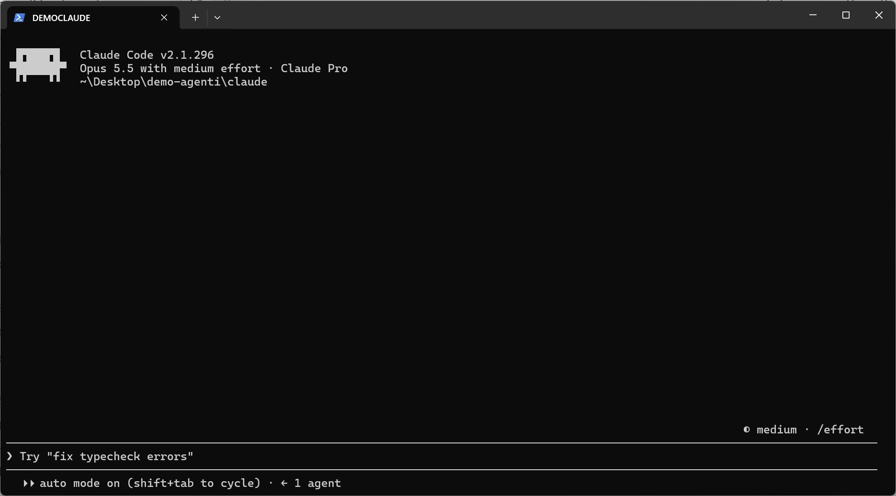
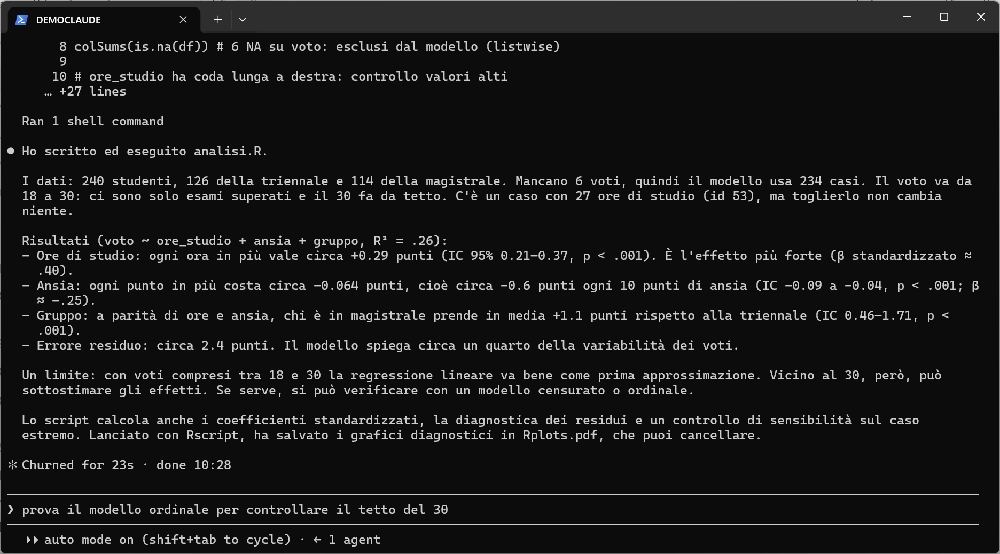
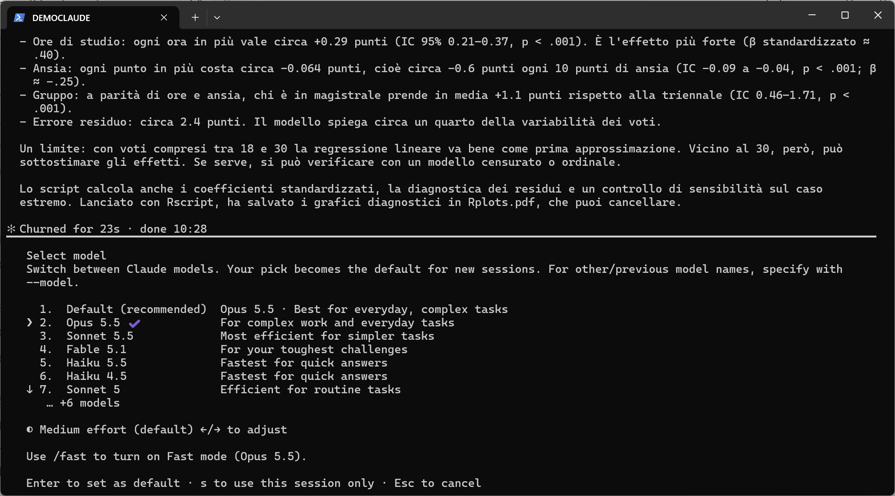
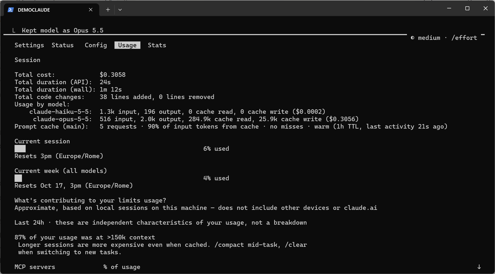
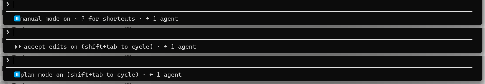
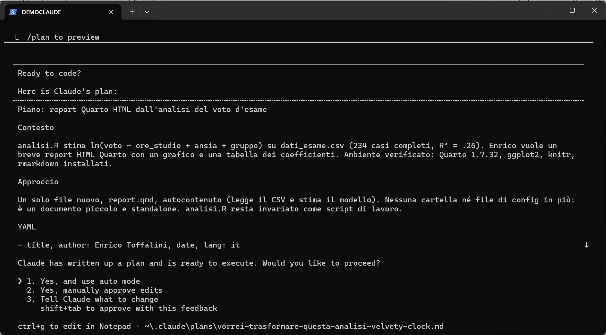
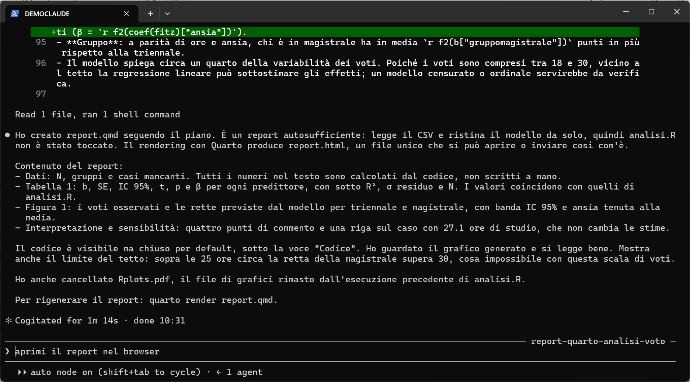

← <a href="index.html">Torna alla parte generale</a> · Vai alla <a href="codex.html">guida a Codex</a>

Questa guida mostra i primi passi con <a href="https://code.claude.com/docs" target="_blank">Claude Code</a> su **Windows** (versione usata: 2.1.296, ottobre 2026). Su macOS e Linux i passaggi sono quasi identici: cambia solo il comando di installazione. Le schermate vengono da una sessione reale, in una cartella di prova con un piccolo dataset simulato.

### Obiettivi della guida

- Installare Claude Code e fare il login.
- Dare la prima richiesta su un progetto.
- Scegliere modello ed *effort*.
- Controllare i limiti di utilizzo residui.
- Capire le modalità di lavoro: *auto*, *manual*, *accept edits*, *plan*.


## Requisiti

- Un account Claude con piano **Pro**, **Max**, **Team** o **Enterprise**. Il piano gratuito **non** include Claude Code (vedi la <a href="index.html">parte generale</a> sui costi).
- Windows 10/11, macOS 13+ o una distribuzione Linux recente.
- Consigliato su Windows: <a href="https://git-scm.com/" target="_blank">Git for Windows</a> (installazione descritta nel <a href="https://enricotoffalini.github.io/blog/posts/tutorial-git-quarto/" target="_blank">tutorial su Git</a>). Non è obbligatorio, ma Claude Code lavora meglio e potete versionare tutto.


## Installazione

Aprite **Windows PowerShell** (cercatelo tra le applicazioni, oppure tasto destro su una cartella → *Apri nel terminale*) e incollate:

`irm https://claude.ai/install.ps1 | iex`

Su **macOS / Linux**, nel terminale:

`curl -fsSL https://claude.ai/install.sh | bash`

L'installazione non mostra una barra di avanzamento: aspettate che finisca. Poi **chiudete e riaprite** il terminale e verificate:

`claude --version`

Se compare un numero di versione, è tutto a posto. Se il comando non viene riconosciuto, il comando `claude doctor` e la <a href="https://code.claude.com/docs/en/troubleshoot-install" target="_blank">pagina di troubleshooting</a> aiutano a capire il problema. Le installazioni fatte in questo modo si aggiornano da sole.


## Primo avvio

Andate nella cartella del progetto su cui volete lavorare, aprite lì il terminale e scrivete:

`claude`

La prima volta si apre il browser per il **login** con il vostro account Claude. Fatto il login, vedrete una schermata simile a questa:

<figure><figcaption>Claude Code appena avviato: in alto versione, modello, effort, piano e cartella di lavoro; in basso la riga dove scrivere e la modalità attiva</figcaption></figure>

In alto trovate le informazioni principali: **modello** (qui Opus 5.5), **effort** (*medium*), **piano** (Pro) e **cartella** di lavoro. Claude Code lavora su quella cartella e sulle sue sottocartelle: è importante lanciarlo nel posto giusto.


## La prima richiesta

Si scrive in linguaggio naturale, in italiano, come in chat. La cartella di prova contiene solo un file `dati_esame.csv`. La richiesta:

> *In questa cartella c'è dati_esame.csv. Dai un'occhiata ai dati, poi scrivi uno script R chiamato analisi.R che stima una regressione del voto su ore_studio, ansia e gruppo, eseguilo e spiegami i risultati in poche righe.*

<figure><figcaption>Claude Code ha esplorato i dati, scritto `analisi.R`, lo ha eseguito con Rscript e ha riassunto i risultati</figcaption></figure>

In 23 secondi Claude Code ha letto il CSV, controllato i valori mancanti e un caso estremo, scritto lo script, lo ha eseguito e ha riassunto i risultati. Ha anche segnalato un limite non richiesto: con voti compresi tra 18 e 30, vicino al tetto la regressione lineare può sottostimare gli effetti. Lo script `analisi.R` ora esiste nella cartella e potete aprirlo in RStudio come qualsiasi altro script.

Si può continuare la conversazione: ogni nuova richiesta parte da tutto quello che è già successo nella sessione. Per **interrompere** l'agente mentre lavora si preme `Esc`.


## Scegliere modello ed effort

Il comando `/model` apre il selettore dei modelli:

<figure><figcaption>Il selettore dei modelli: con le frecce su/giù si sceglie il modello, con le frecce sinistra/destra il livello di effort</figcaption></figure>

In breve:

- **Opus**: il default, adatto alla maggior parte del lavoro, anche complesso.
- **Sonnet**: più economico, va bene per compiti semplici e consuma meno i limiti.
- **Fable**: il più potente, per i problemi più difficili, ma consuma i limiti più in fretta.
- **Haiku**: molto veloce, per domande rapide.

L'**effort** regola quanto il modello ragiona prima di agire: `low`, `medium`, `high`, `xhigh`, `max`. Più effort significa risposte più accurate su problemi difficili, ma più lente e più costose in termini di limiti. Si cambia con le frecce sinistra/destra nel selettore, oppure direttamente:

`/effort high`

Il modello scelto con `Invio` diventa il default per le sessioni successive; premendo `s` vale solo per la sessione corrente. Si possono anche impostare all'avvio:

`claude --model sonnet --effort low`

Un consiglio pratico: partite con il default (Opus, effort medio). Alzate l'effort quando un compito è difficile o l'agente sbaglia. Usate Sonnet per lavori ripetitivi e semplici.


## Controllare l'utilizzo residuo

Il comando `/usage` mostra quanto avete consumato:

<figure><figcaption>Il pannello `/usage`: costo stimato della sessione, e soprattutto la percentuale di limite usata nella sessione corrente (finestra di 5 ore) e nella settimana</figcaption></figure>

Le voci più importanti sono **Current session** (il limite sulla finestra di 5 ore) e **Current week** (il limite settimanale), con l'orario in cui si azzerano. Le percentuali si riferiscono a tutto l'uso del vostro account (anche da altre sessioni o da claude.ai), non solo alla conversazione aperta. Il "Total cost" in dollari è solo indicativo: con un abbonamento non pagate per singola richiesta, ma consumate i limiti del piano. Raggiunto un limite, Claude Code si ferma fino all'azzeramento, salvo che abbiate attivato il pagamento a consumo (vedi la <a href="index.html">parte generale</a>).

Il pannello dà anche suggerimenti utili: ad esempio, le conversazioni molto lunghe costano di più. Quando cambiate argomento conviene ripartire con `/clear`; a metà di un lavoro lungo si può usare `/compact`, che riassume la conversazione e libera spazio.


## Le modalità di lavoro

Con `Shift+Tab` si passa ciclicamente tra le modalità di lavoro. La modalità attiva è indicata in basso:

<figure><figcaption>Premendo `Shift+Tab` si passa da *auto* a *manual*, *accept edits* e *plan*</figcaption></figure>

- **auto** (il default nelle versioni recenti): Claude Code agisce senza chiedere, ma un secondo modello controlla in background ogni azione e blocca quelle potenzialmente pericolose. È la modalità più comoda per lavori lunghi.
- **manual**: chiede il permesso prima di quasi ogni azione (modificare file, eseguire comandi, accedere alla rete). Lenta, ma è utile all'inizio per capire come lavora, o su materiale delicato.
- **accept edits**: modifica i file senza chiedere, ma chiede prima di eseguire comandi.
- **plan**: legge ed esplora, ma **non modifica nulla**. Prima propone un piano; solo se lo approvate passa all'esecuzione.

La modalità *plan* è la più sottovalutata. Per qualsiasi compito non banale conviene chiedere prima un piano. Nell'esempio ho chiesto, in modalità *plan*:

> *Vorrei trasformare questa analisi in un breve report Quarto in HTML, con un grafico e una tabella dei coefficienti. Prima di toccare qualsiasi file, proponimi un piano.*

<figure><figcaption>Il piano proposto: contesto, approccio, file da creare. In fondo si sceglie se procedere (in modalità auto o con approvazione manuale) o chiedere modifiche</figcaption></figure>

Il piano dice esattamente cosa verrà creato e cosa resterà invariato. Prima di approvarlo, potete correggerlo (opzione 3) o modificarlo a mano (`Ctrl+G`). Approvato il piano, Claude Code ha creato `report.qmd`, lo ha renderizzato con Quarto e ha controllato il grafico prodotto:

<figure><figcaption>Fine del lavoro: riepilogo di cosa contiene il report e di come rigenerarlo</figcaption></figure>

Il report finale è mostrato nella <a href="index.html#un-esempio-concreto-stesso-compito-due-agenti">parte generale</a>.


## Riprendere una conversazione

Le conversazioni restano salvate sul vostro computer, legate alla cartella in cui le avete aperte. Se chiudete il terminale per sbaglio, o se il lavoro si è interrotto per un limite di utilizzo, potete riprendere da dove eravate, con tutto il contesto. Dalla stessa cartella:

```
claude -c          # riprende l'ultima conversazione
claude -r          # mostra l'elenco delle conversazioni passate e ne fa scegliere una
```

Dentro una sessione già aperta, `/resume` mostra lo stesso elenco.


## Altri comandi utili

| Comando | A cosa serve |
|---|---|
| `/init` | Crea un file `CLAUDE.md` con una descrizione del progetto, che Claude Code legge a ogni avvio. Potete aggiungervi convenzioni e istruzioni. |
| `claude -c` | Riprende l'ultima conversazione in quella cartella. `/resume` permette di scegliere tra quelle passate. |
| `/clear` | Nuova conversazione, contesto vuoto. |
| `/compact` | Riassume la conversazione per liberare spazio, senza perderne il filo. |
| `/context` | Mostra quanto spazio di contesto è occupato. |
| `/rewind` | Torna a un punto precedente della conversazione e, se volete, anche del codice. |
| `/status` | Versione, modello, account. |
| `/mcp`, `/skills` | Mostrano connettori e skill disponibili. |
| `!comando` | Esegue direttamente un comando del terminale (es. `!git status`). |
| `/exit` | Chiude Claude Code. |

Digitando `/` compare l'elenco completo dei comandi.


## Connettori e browser

Se sul vostro account <a href="https://claude.ai" target="_blank">claude.ai</a> avete attivato dei connettori (Gmail, Google Calendar, Google Drive, ecc.), con lo stesso login sono disponibili anche in Claude Code. Per far usare il browser all'agente serve l'estensione <a href="https://chromewebstore.google.com/detail/claude/fcoeoabgfenejglbffodgkkbkcdhcgfn" target="_blank">Claude in Chrome</a> (funziona anche con Edge). Poi si avvia Claude Code con `claude --chrome`; il comando `/chrome` mostra lo stato della connessione e permette di abilitarla di default. L'agente apre le proprie schede, ma usa i login del vostro browser: può quindi agire su qualsiasi sito in cui siete già autenticati. Per questo i permessi per ciascun sito si gestiscono dall'estensione, e conviene concederli con giudizio.

---

← <a href="index.html">Torna alla parte generale</a> · Vai alla <a href="codex.html">guida a Codex</a>
