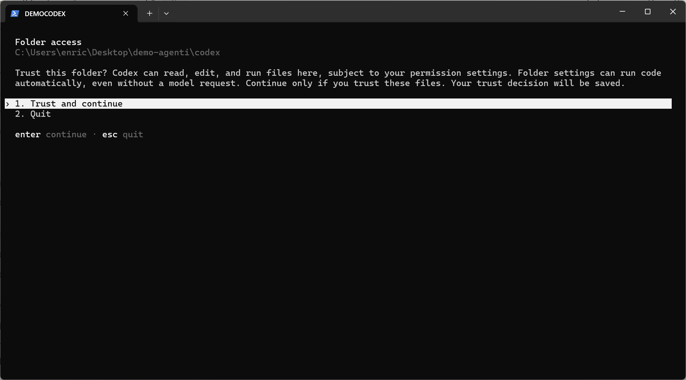
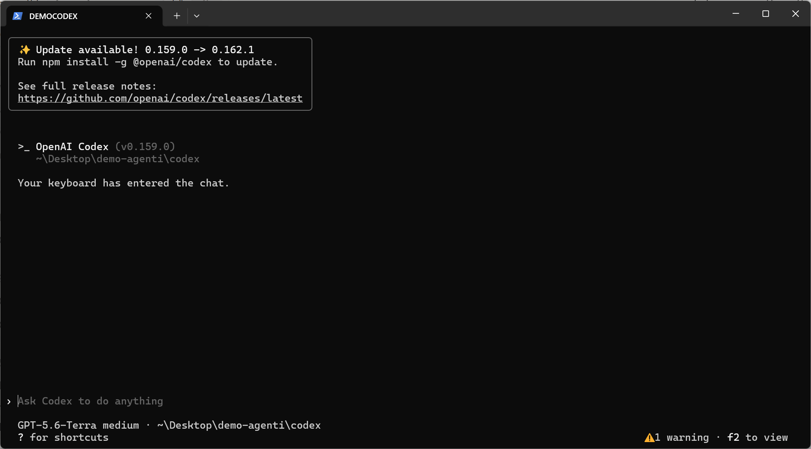
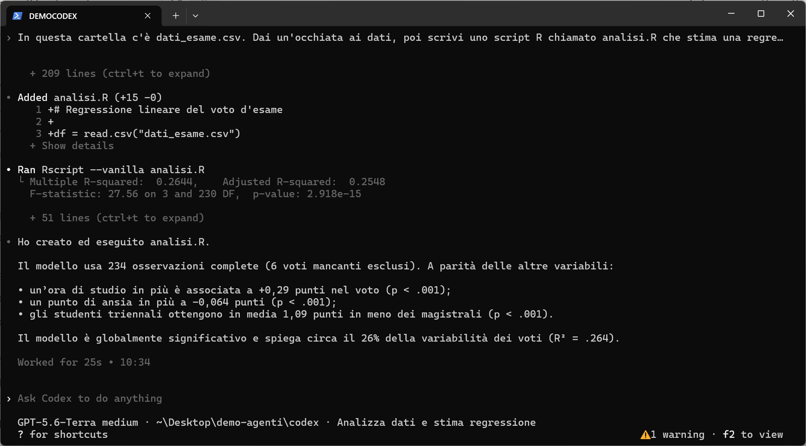
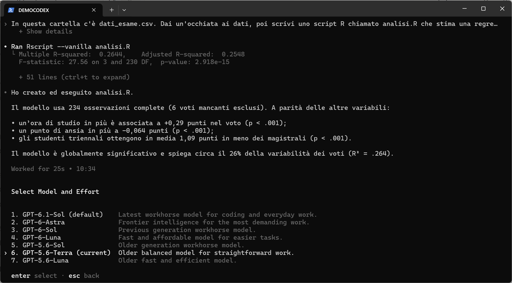
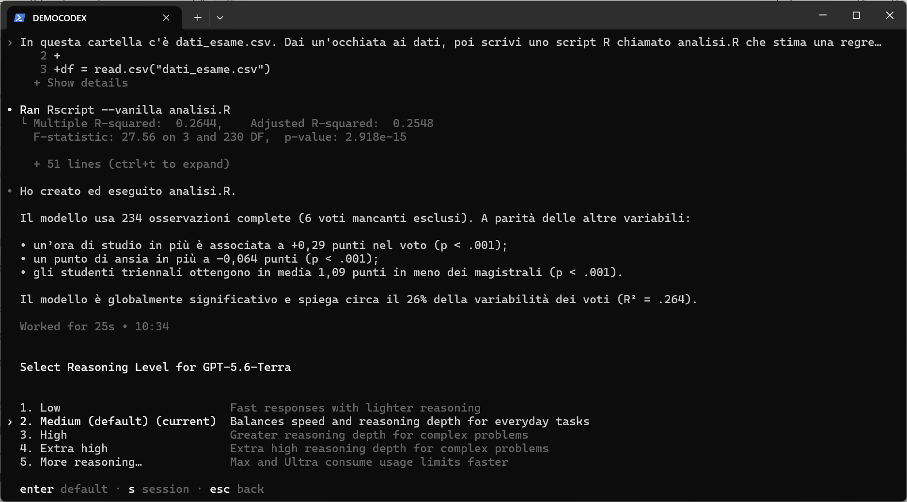
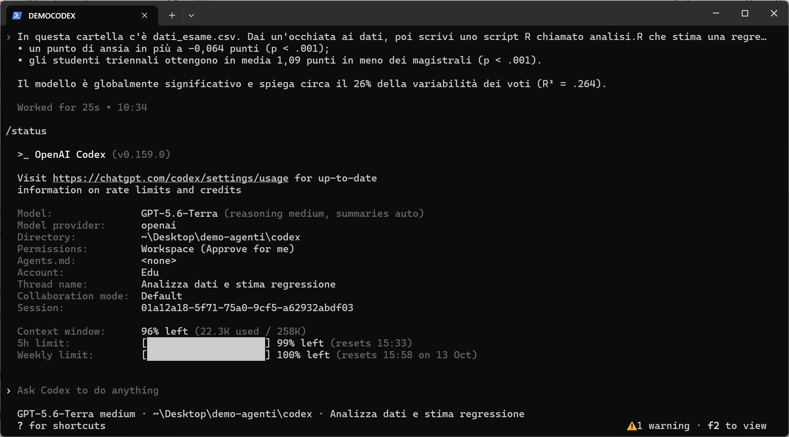
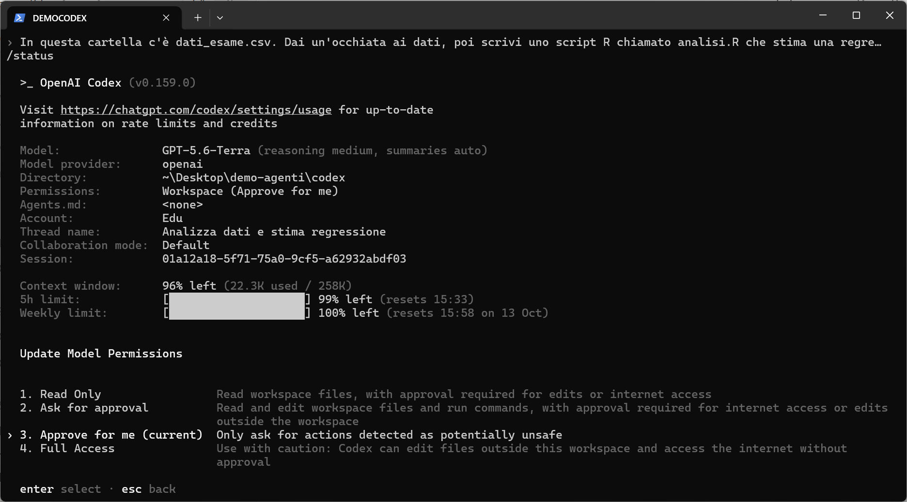
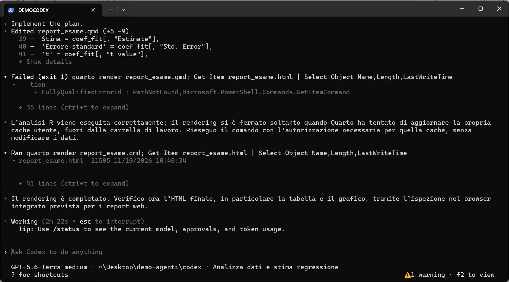
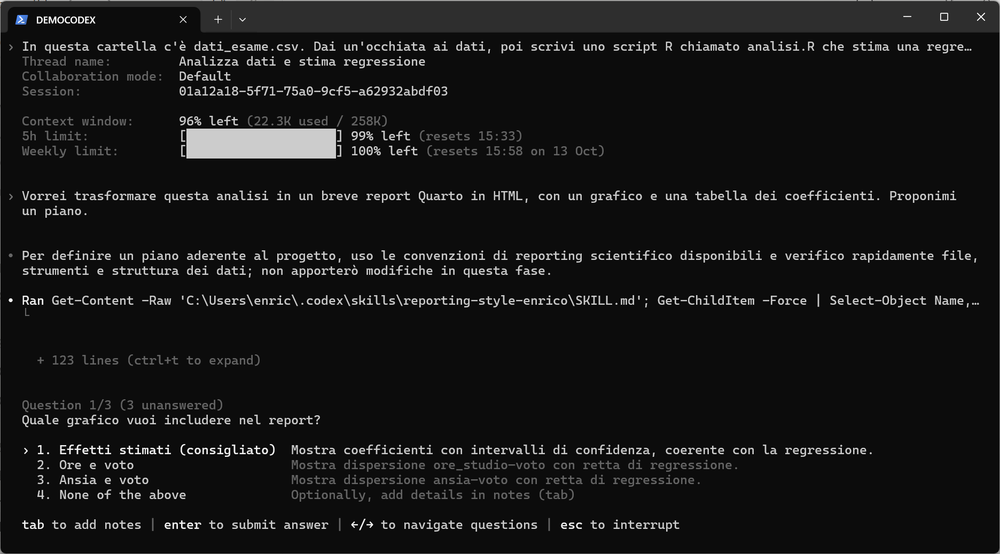
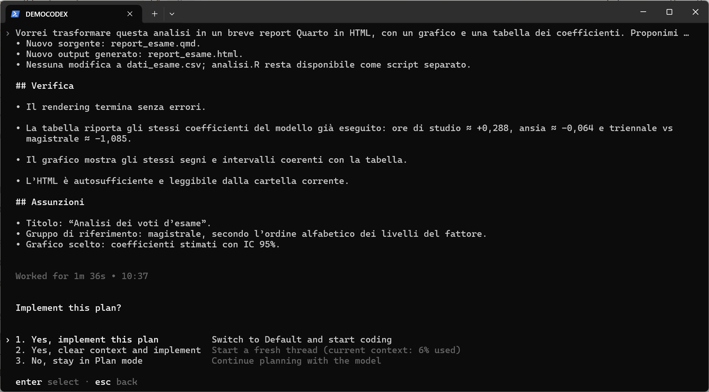

← <a href="index.html">Torna alla parte generale</a> · Vai alla <a href="claude-code.html">guida a Claude Code</a>

> **Chi ha scritto questo post.** Di fatto, l'ha scritto **Claude** (Anthropic), lavorando come agente in Claude Code, e ha prodotto anche le schermate, pilotando da sé Codex in un'altra finestra. Io ho fornito i materiali, l'esperienza e le indicazioni, e ho supervisionato e rivisto il risultato. La prima persona nel testo resta la mia, perché esperienze e opinioni sono mie. Lo dico per onestà, ma anche perché è un esempio concreto di quello che questa serie racconta: un agente AI, personalizzato con le mie skill (vedi il <a href="../skills/index.html">post sulle skill</a>), può svolgere gran parte di un lavoro come questo, purché riceva buone indicazioni e qualcuno controlli quello che fa.

Questa guida mostra i primi passi con <a href="https://github.com/openai/codex" target="_blank">Codex CLI</a> di OpenAI su **Windows** (versione usata: 0.159.0, ottobre 2026), con un account **ChatGPT Edu** fornito dall'ateneo. Su macOS e Linux cambia solo il comando di installazione. Le schermate vengono da una sessione reale, nella stessa cartella di prova usata per la <a href="claude-code.html">guida a Claude Code</a>.

### Obiettivi della guida

- Installare Codex e fare il login.
- Dare la prima richiesta su un progetto.
- Scegliere modello e livello di ragionamento.
- Controllare i limiti di utilizzo residui.
- Capire permessi e *plan mode*.


## Requisiti

- Un account ChatGPT con piano **Plus**, **Pro**, **Business**, **Edu** o **Enterprise** (vedi la <a href="index.html">parte generale</a> sui costi). Se il vostro ateneo fornisce ChatGPT Edu, potete usare quello.
- Windows, macOS o Linux.
- Consigliato: <a href="https://git-scm.com/" target="_blank">Git</a> (vedi il <a href="https://enricotoffalini.github.io/blog/posts/tutorial-git-quarto/" target="_blank">tutorial su Git</a>).


## Installazione

Su **Windows**, in PowerShell:

`powershell -ExecutionPolicy ByPass -c "irm https://chatgpt.com/codex/install.ps1 | iex"`

Su **macOS / Linux**:

`curl -fsSL https://chatgpt.com/codex/install.sh | sh`

In alternativa, se avete già <a href="https://nodejs.org/" target="_blank">Node.js</a>, su qualsiasi sistema:

`npm install -g @openai/codex`

Chiudete e riaprite il terminale e verificate con `codex --version`. Codex segnala da solo quando è disponibile un aggiornamento e propone di installarlo.


## Primo avvio

Aprite il terminale nella cartella del progetto e scrivete:

`codex`

La prima volta vi chiede di accedere: scegliete **Sign in with ChatGPT** e completate il login nel browser. Poi, per ogni nuova cartella, Codex chiede se vi fidate del suo contenuto:

<figure><figcaption>Alla prima apertura di una cartella Codex chiede se fidarsi: la decisione viene ricordata</figcaption></figure>

Rispondete sì solo per cartelle vostre o di cui conoscete il contenuto: le impostazioni di un progetto possono eseguire codice. Fatto questo si arriva alla schermata principale:

<figure><figcaption>Codex pronto: in basso il modello attivo (GPT-5.6-Terra), il livello di ragionamento (*medium*) e la cartella di lavoro</figcaption></figure>


## La prima richiesta

Stessa richiesta data a Claude Code:

> *In questa cartella c'è dati_esame.csv. Dai un'occhiata ai dati, poi scrivi uno script R chiamato analisi.R che stima una regressione del voto su ore_studio, ansia e gruppo, eseguilo e spiegami i risultati in poche righe.*

<figure><figcaption>Codex ha creato `analisi.R` (si vedono le righe aggiunte), lo ha eseguito con Rscript e ha riassunto i risultati</figcaption></figure>

In 25 secondi Codex ha esplorato i dati, scritto lo script, lo ha eseguito e ha riassunto i risultati, identici a quelli ottenuti da Claude Code. Ogni passaggio è visibile: il file aggiunto (`Added analisi.R (+15 -0)`), il comando eseguito (`Ran Rscript --vanilla analisi.R`) e il suo output. Con `Ctrl+T` si espande il dettaglio completo. Per interrompere l'agente mentre lavora si preme `Esc`.


## Scegliere modello e livello di ragionamento

Il comando `/model` apre il selettore dei modelli:

<figure><figcaption>Il selettore dei modelli di Codex, con una breve descrizione di ciascuno</figcaption></figure>

I nomi cambiano spesso, ma le descrizioni aiutano. Il modello di default è quello consigliato per il lavoro quotidiano; ci sono modelli più potenti per i compiti difficili e modelli più veloci ed economici per quelli semplici. Scelto il modello, Codex chiede il **livello di ragionamento** (*reasoning effort*):

<figure><figcaption>Il livello di ragionamento: da *Low* a *Extra high*, più i livelli *Max* e *Ultra* che consumano i limiti molto più in fretta</figcaption></figure>

Con `Invio` la scelta diventa il default; premendo `s` vale solo per la sessione corrente. Si può anche indicare il modello all'avvio con `codex -m <nome-modello>`. Il consiglio è lo stesso dato per Claude Code: partite dal default con ragionamento *medium*, alzatelo solo per i problemi difficili.


## Controllare l'utilizzo residuo

Il comando `/status` mostra la configurazione della sessione e i limiti residui:

<figure><figcaption>`/status`: modello, permessi, tipo di account (qui Edu), contesto usato e, in fondo, i limiti sulla finestra di 5 ore e settimanale</figcaption></figure>

Le ultime tre righe sono le più utili. **Context window** indica quanto della "memoria di lavoro" della conversazione è occupato. **5h limit** e **Weekly limit** indicano quanto resta dei limiti del vostro piano e quando si azzerano. Il dettaglio aggiornato, inclusi eventuali crediti, è sulla pagina <a href="https://chatgpt.com/codex/settings/usage" target="_blank">chatgpt.com/codex/settings/usage</a>. I limiti valgono per tutte le interfacce di Codex, non solo per il terminale. Raggiunto un limite, Codex si ferma fino all'azzeramento, salvo che il piano preveda crediti aggiuntivi (vedi la <a href="index.html">parte generale</a>; con un account Edu dipende dall'ateneo).


## Permessi

Il comando `/permissions` stabilisce cosa Codex può fare senza chiedere:

<figure><figcaption>I quattro livelli di permesso di Codex</figcaption></figure>

- **Read Only**: legge i file, ma chiede il permesso per qualsiasi modifica o accesso a internet.
- **Ask for approval**: legge, modifica ed esegue comandi nella cartella di lavoro; chiede per internet e per file fuori dalla cartella.
- **Approve for me**: chiede solo per le azioni giudicate potenzialmente pericolose; le altre vengono valutate e approvate automaticamente.
- **Full Access**: nessuna richiesta, anche fuori dalla cartella e su internet. Da usare con molta cautela.

Codex lavora dentro una ***sandbox***: di default può scrivere solo nella cartella del progetto. Nell'esempio si vede bene. Il rendering del report Quarto è fallito perché Quarto doveva aggiornare una propria cache fuori dalla cartella di lavoro. Codex ha riconosciuto il problema, ha richiesto l'autorizzazione (approvata automaticamente in modalità *Approve for me*) e ha rieseguito il comando:

<figure><figcaption>Il primo rendering fallisce per i limiti della sandbox; Codex chiede l'autorizzazione necessaria e il secondo tentativo riesce</figcaption></figure>


## Plan mode

Con `Shift+Tab`, oppure con il comando `/plan`, si attiva la **Plan mode** (l'indicazione compare in basso a destra). In questa modalità Codex esplora e progetta, ma non modifica nulla. Ho chiesto:

> *Vorrei trasformare questa analisi in un breve report Quarto in HTML, con un grafico e una tabella dei coefficienti. Proponimi un piano.*

Prima di proporre il piano, Codex ha fatto una cosa interessante: ha letto da solo la mia skill sullo stile dei report scientifici (`reporting-style-enrico`, vedi la <a href="index.html">parte generale</a>) e poi mi ha posto alcune domande:

<figure><figcaption>In plan mode Codex fa domande prima di decidere: qui quale grafico includere, con un'opzione consigliata</figcaption></figure>

Risposte le domande, presenta il piano: file che verranno creati, verifiche che farà, assunzioni adottate. A quel punto si sceglie se implementarlo:

<figure><figcaption>La parte finale del piano e la richiesta di conferma: implementare, implementare ripartendo con un contesto pulito, oppure continuare a pianificare</figcaption></figure>

Il report risultante è mostrato nella <a href="index.html#un-esempio-concreto-stesso-compito-due-agenti">parte generale</a>, accanto a quello di Claude Code.


## Riprendere una conversazione

Le conversazioni restano salvate sul vostro computer. Se chiudete il terminale per sbaglio, o se il lavoro si è interrotto per un limite di utilizzo, potete riprendere da dove eravate, con tutto il contesto. Dalla stessa cartella:

```
codex resume --last   # riprende l'ultima conversazione
codex resume          # mostra l'elenco delle conversazioni passate e ne fa scegliere una
```

Dentro una sessione già aperta, `/resume` mostra lo stesso elenco.


## Altri comandi utili

| Comando | A cosa serve |
|---|---|
| `/init` | Crea un file `AGENTS.md` con le istruzioni del progetto, che Codex legge a ogni avvio. |
| `codex resume` | Riprende una conversazione passata (`codex resume --last` per l'ultima). |
| `/new` | Nuova conversazione nella stessa sessione. |
| `/compact` | Riassume la conversazione per liberare contesto. |
| `/review` | Revisione delle modifiche fatte, alla ricerca di problemi. |
| `/mcp` | Mostra i connettori (server MCP) configurati. |
| `codex exec "..."` | Esegue un compito senza interfaccia interattiva (utile in script). |
| `/quit` | Chiude Codex. |

Digitando `/` compare l'elenco completo dei comandi.


## Una nota su ChatGPT Edu

Con l'account Edu di ateneo Codex funziona bene per tutto il lavoro in locale mostrato qui. Alcune funzioni però possono essere disattivate dall'amministrazione: in questo momento, ad esempio, l'uso del browser da parte di Codex non è disponibile perché bloccato per scelta dell'ateneo. Se una funzione non compare o non funziona, è probabile che dipenda da queste impostazioni e non da un vostro errore.

---

← <a href="index.html">Torna alla parte generale</a> · Vai alla <a href="claude-code.html">guida a Claude Code</a>
