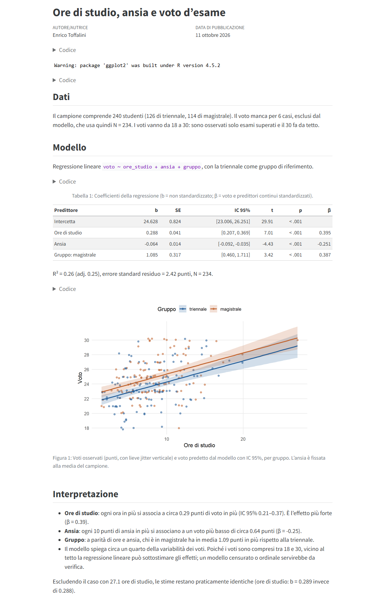
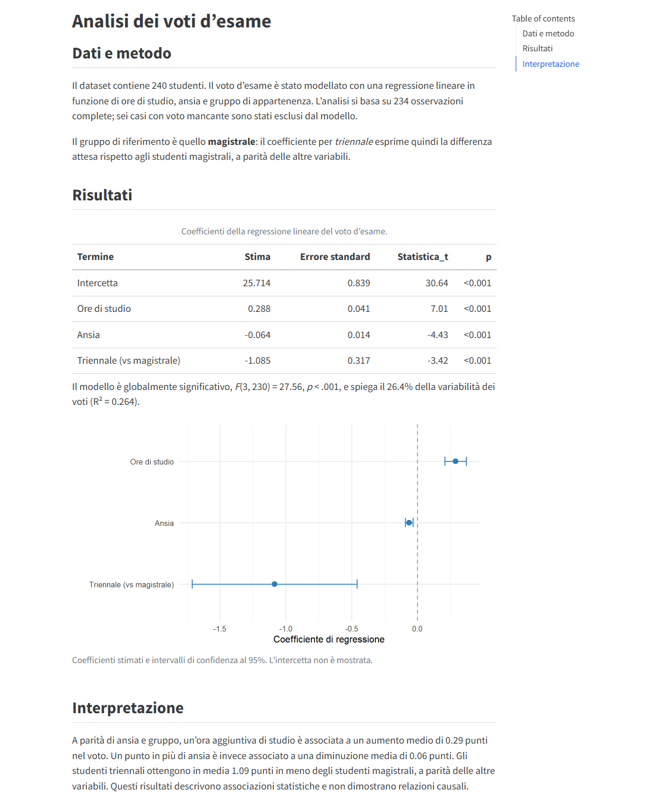

Chi usa l'AI solo dalla chat nel browser ne sta usando una frazione. Gli **agenti AI in locale**, come <a href="https://code.claude.com/docs" target="_blank">**Claude Code**</a> di Anthropic e <a href="https://github.com/openai/codex" target="_blank">**Codex**</a> di OpenAI, lavorano direttamente sui file del vostro computer: leggono una cartella di progetto, scrivono e modificano script, li eseguono, guardano gli errori, correggono, rieseguono. Non vi restituiscono un pezzo di codice da copiare e incollare: fanno il lavoro nella cartella e vi dicono cosa hanno fatto. Si possono usare dal **terminale** (*command line interface*, CLI), che è il modo che preferisco, oppure da **app desktop**, che fanno lo stesso lavoro con menu e pannelli al posto dei comandi.

Questo post ha quattro parti:

- una parte generale su cosa cambia rispetto alla chat nel browser (questa pagina);
- una <a href="claude-code.html">**guida passo-passo a Claude Code**</a> da terminale;
- una <a href="codex.html">**guida passo-passo a Codex**</a> da terminale;
- una <a href="app-desktop.html">**guida alle app desktop**</a> di entrambi, per chi preferisce evitare il terminale.

Le guide mostrano installazione, primo utilizzo, scelta del modello e dello sforzo di ragionamento (*effort*), controllo dei limiti di utilizzo e modalità di lavoro (automatica, con approvazione, *plan*). Non sono guide esaustive. Coprono le cose che servono per partire.

<figure><figcaption>Claude Code ha letto un dataset, scritto ed eseguito uno script R e riassunto i risultati, in 23 secondi, da una sola richiesta in italiano</figcaption></figure>

# Cosa cambia rispetto alla chat nel browser

### 1. L'agente lavora sui vostri file, non su copie incollate

Nella chat si carica un file, si riceve una risposta, si copia il codice in RStudio, si lancia, si incolla l'errore nella chat, e così via. Con un agente in locale questo ciclo sparisce. Lo lanciate dentro una cartella (dal terminale, o selezionandola nell'app) e lui vede tutto quello che c'è: dati, script, documenti Quarto, bibliografie, configurazioni. Può creare file nuovi, modificare quelli esistenti, eseguire R, Python, Quarto, Git, e qualsiasi altro programma installato.

La differenza pratica è enorme quando il progetto non è un singolo script ma una **repository** con decine di file che dipendono l'uno dall'altro: un articolo con analisi, figure e supplementari; un sito; un pacchetto R; una app.

### 2. Il contesto è ricco e non va aggiornato a mano

In chat il contesto è quello che incollate voi, e va ricostruito a ogni nuova conversazione. L'agente invece ricostruisce il contesto leggendo il progetto stesso: la struttura delle cartelle, il codice, la cronologia Git, i file di istruzioni del progetto (`CLAUDE.md` per Claude Code, `AGENTS.md` per Codex), che possono contenere convenzioni, obiettivi, cose da non toccare. Se il progetto cambia, il contesto cambia con lui, senza che dobbiate ricaricare nulla.

A questo si aggiungono le **skill**: file di istruzioni riutilizzabili su come fare certe cose (ad esempio come scrivo codice, come imposto un report, come scrivo una email). L'agente le carica quando servono. Le mie sono pubbliche <a href="https://github.com/EnricoToffalini/ai-skills" target="_blank">qui</a>. Nella demo della <a href="codex.html">guida a Codex</a> si vede Codex che, prima di proporre un report, va a leggersi da solo la mia skill sullo stile dei report scientifici. Ne parlo in dettaglio nel <a href="../skills/index.html">post dedicato alle skill</a>.

### 3. Molto più controllo sul processo

Sembra un paradosso, ma l'agente che "fa da solo" dà più controllo della chat, non meno:

- vedete **ogni comando** che esegue e **ogni modifica** ai file, riga per riga;
- decidete il livello di autonomia: approvare ogni azione, approvare solo quelle rischiose, oppure chiedere prima un **piano** e solo dopo l'esecuzione;
- se il progetto è sotto **Git** (vivamente consigliato: vedi il <a href="https://enricotoffalini.github.io/blog/posts/tutorial-git-quarto/" target="_blank">tutorial su Git e GitHub</a>), ogni modifica è tracciata e reversibile;
- i risultati sono script e file veri, eseguibili e riproducibili, non testo in una chat.

### 4. Può agire anche fuori dal computer, tramite connettori

Attraverso i **connettori** (tecnicamente server *MCP*) e l'estensione per il browser, un agente può leggere la posta, inserire impegni nel calendario, lavorare su Google Drive, navigare siti web, compilare moduli. Questo va abilitato esplicitamente e richiede cautela, ma apre possibilità notevoli. Qualche esempio dal mio uso reale:

- far rivedere a Claude **l'intera struttura di un corso Moodle**, inclusi forum e quiz, segnalando problemi, incoerenze e contraddizioni tra le varie parti;
- farmi assistere in una pratica online, nello specifico **la richiesta di assegnazione del medico di base**, navigando il sito e compilando i campi per mio conto;
- una <a href="https://github.com/EnricoToffalini/ai-skills" target="_blank">skill</a> che legge le mail recenti e **inserisce automaticamente riunioni, scadenze e impegni nel calendario giusto**, secondo le mie categorie e convenzioni sui nomi, e poi mi riporta cosa ha fatto per la verifica.

Una nota pratica: in questo momento Codex con l'account **ChatGPT Edu** fornito dall'ateneo non può usare il browser, perché questa funzione è disattivata per scelta dell'ateneo. Claude Code con l'estensione per Chrome invece funziona.

### 5. Soprattutto: progetti interi, in locale, con molta potenza

Il punto di forza principale resta però la creazione e gestione di **progetti complessi**. Qualche esempio di cose che ho sviluppato negli ultimi mesi lavorando con questi agenti:

- **progetti di ricerca** con revisione della letteratura e simulazioni (es. <a href="https://enricotoffalini.github.io/Most_interactions_are_wrong/" target="_blank">Most interactions are wrong</a>; <a href="https://github.com/EnricoToffalini/Taxometrics-Neurodevelopmental-Disorders" target="_blank">Taxometrics in neurodevelopmental disorders</a>);
- **siti didattici** articolati (es. <a href="https://enricotoffalini.github.io/psicologia-intelligenza/" target="_blank">Psicologia dell'intelligenza</a>);
- **app interattive** (es. <a href="https://github.com/EnricoToffalini/Dimensioni-Diagnosi-App" target="_blank">un laboratorio su dimensioni continue e categorie diagnostiche</a> e perfino una demo di <a href="https://github.com/EnricoToffalini/mahabharata-game" target="_blank">videogioco</a> in Godot);
- **siti statici ed edizioni web** di testi, con originale, traduzione e glossario (es. questo piccolo <a href="https://enricotoffalini.github.io/IDS-2-estensioni/" target="_blank">sito informativo sugli indici IDS-2</a>, o godetevi queste <a href="https://enricotoffalini.github.io/Epitteto-Diatribe/" target="_blank">Diatribe di Epitteto</a>);
- **raccolte documentali** (es. <a href="https://enricotoffalini.github.io/trasparenza-dati-normativi/" target="_blank">trasparenza e dati normativi</a>).

Molte di queste cose richiederebbero competenze di sviluppo web o software che chi fa ricerca in psicologia di solito non ha. Con un agente si possono fare, purché si sappia cosa si vuole e si controlli quello che viene prodotto.

::: {.callout-important appearance="simple" icon="false"}
**Il valore aggiunto: UN SOLO CENTRO DI COMANDO!** Un progetto non sta mai in un posto solo. Molto è in una cartella sul vostro computer, ma poi le decisioni stanno nelle mail e negli allegati, le versioni condivise sono su Drive, le scadenze nel calendario, la grafica su Canva, ecc. Il collante, finora, siamo noi: saltiamo tra finestre e piattaforme, scarichiamo allegati, trascriviamo date, ricordiamo chi ha deciso cosa. Questo collante è spesso la parte più faticosa e fragile del lavoro. 

Un agente lanciato nella cartella del progetto, con i connettori attivi, quel collante lo sopperisce bene: vede tutto nello stesso momento e (se vogliamo) può agire su tutto. Non è soltanto più veloce di noi. Ha una **visione d'insieme con un contesto cognitivo che facilmente supera il nostro**, perché nessuno tiene a mente insieme cartella, file, versioni, posta, calendario e Drive. Vale per un articolo scritto a più mani come per un convegno da organizzare. Anzi, il lavoro organizzativo, il più frammentato di tutti, è proprio quello che ci guadagna di più. Ed è esattamente ciò che manca alla chat nel browser: i connettori ce li ha, la cartella con il progetto vero no. 

Non succede da solo, però: **va strutturato**. La cartella del progetto diventa il centro di comando, e il file di istruzioni del progetto (**`AGENTS.md`** [o **`CLAUDE.md`** se si lavora esclusivamente con Claude]) la mappa di tutto quello che sta fuori: quale etichetta della posta, quale cartella di Drive, quale calendario, chi sono i collaboratori. Un file di note tiene lo stato del lavoro da una sessione all'altra; le procedure ricorrenti vanno nelle <a href="../skills/index.html">skill</a>. E comunque l'agente legge tutto, suggerisce, abbozza... ma poi mail, eventi e condivisioni partono solo con il vostro click esplicito.
:::

::: {.callout-tip appearance="simple" icon="false"}
**Formati aperti: un motivo in più.** Gli agenti rendono al meglio sui file di **testo semplice**: `.R`, `.py`, `.qmd`, `.md`, `.csv`, `.bib`. Li leggono direttamente, li modificano riga per riga, e ogni modifica si vede (e si annulla) con Git. Con i formati proprietari o binari (`.docx`, `.xlsx`, `.pptx`, `.sav`...) ce la fanno lo stesso, grazie alle skill e a librerie apposite, ma con un giro molto più lungo: estrarre il contenuto, modificarlo, ricomporre il file, renderizzarlo per controllare che la formattazione non sia saltata. Più tempo, più consumo dei limiti, più occasioni di errore. È lo stesso argomento dei principi <a href="https://mar-cald.github.io/fair/" target="_blank">**FAIR**</a>, da un'altra angolazione: quello che è leggibile da chiunque senza software particolari è leggibile e interoperabile meglio anche dall'AI. Se serviva una scusa per passare da Word ed Excel a Quarto e CSV+R, eccola!

Detto questo, se si deve restare su Word (ad esempio per un documento condiviso con colleghi), esiste il componente aggiuntivo <a href="https://claude.com/docs/office-agents/word" target="_blank">**Claude for Word**</a> (piani a pagamento): lavora in un pannello laterale dentro Word, propone le modifiche come **revisioni** da accettare o rifiutare e risponde ai commenti. OpenAI ha l'equivalente, *ChatGPT for Word*, ma negli account di ateneo deve essere abilitato dagli amministratori.
:::

# Un esempio concreto: stesso compito, due agenti

Per le guide ho dato a entrambi gli agenti lo stesso compito, nella stessa cartella con lo stesso dataset simulato (240 studenti, ore di studio, ansia, gruppo triennale/magistrale, voto d'esame).

::: {.callout-note appearance="simple" icon="false"}
**Nota sui dati.** Il dataset e l'analisi di regressione sono un esempio giocattolo **inventato da Claude**, di sua iniziativa, solo per mostrare come lavorano gli agenti. I dati sono simulati, e numeri, variabili e risultati non hanno nulla a che vedere con ricerche, dati o analisi mie, né di nessun altro.
:::

La richiesta era questa:

> *In questa cartella c'è dati_esame.csv. Dai un'occhiata ai dati, poi scrivi uno script R chiamato analisi.R che stima una regressione del voto su ore_studio, ansia e gruppo, eseguilo e spiegami i risultati in poche righe.*

Entrambi hanno impiegato circa 25 secondi e ottenuto gli stessi coefficienti. Poi ho chiesto, in modalità *plan*, di trasformare l'analisi in un breve report Quarto con un grafico e una tabella. Questi sono i due report prodotti, senza alcun ritocco:

::: {.columns}
::: {.column width="50%"}
<figure><figcaption>Report prodotto da Claude Code</figcaption></figure>
:::
::: {.column width="50%"}
<figure><figcaption>Report prodotto da Codex</figcaption></figure>
:::
:::

Due dettagli istruttivi. Primo: i due agenti hanno fatto **scelte diverse ma entrambe legittime** (gruppo di riferimento opposto, grafico diverso, tabella con o senza coefficienti standardizzati). Claude ha anche segnalato spontaneamente un limite reale dei dati: il voto ha un tetto a 30, quindi la regressione lineare può sottostimare gli effetti. Secondo: nessuno dei due vi esonera dal **leggere quello che hanno fatto**. Sono strumenti molto capaci, non arbitri della correttezza.

# Cose da sapere prima di cominciare

### Bisogna investire qualcosa

Siamo onesti: **servono piani a pagamento**. I piani gratuiti non includono Claude Code, e per Codex offrono al massimo un assaggio molto limitato. I listini sono in dollari e **IVA esclusa**: in Italia all'importo si aggiunge l'IVA al 22%. Indicativamente, a ottobre 2026:

- **Claude Code**: richiede almeno il piano **Pro**, che in Italia costa di fatto circa **22 € al mese** IVA inclusa (un po' meno con pagamento annuale). Per un uso intenso servono i piani **Max**, che partono da 100 \$ al mese più IVA, quindi oltre 100 € al mese.
- **Codex**: è incluso nei piani ChatGPT **Plus** (20 \$ al mese più IVA, quindi anche qui poco più di 20 € al mese), **Pro**, **Business**, **Edu** ed **Enterprise**.

I prezzi cambiano spesso; verificate sulle pagine ufficiali (<a href="https://claude.com/pricing" target="_blank">Claude</a>, <a href="https://chatgpt.com/pricing" target="_blank">ChatGPT</a>). Con i piani base i **limiti di utilizzo** (calcolati su finestre di 5 ore e su base settimanale) si raggiungono abbastanza in fretta se si lavora su progetti grandi o con i modelli più potenti. Nelle guide mostro come controllarli.

In breve: quando un limite si esaurisce, l'agente si ferma fino all'azzeramento. Il consumo dipende dalla quantità di lavoro più che dal numero di messaggi: modelli più potenti, *effort* più alto e conversazioni lunghe consumano di più. A differenza dell'uso via API, dove si paga per token, nei piani in abbonamento non è definito con precisione quanto lavoro stia in una finestra; ci si regola con un po' di esperienza. Nella mia esperienza, se non si sviluppa software o progetti molto articolati, una finestra di 5 ore basta per numerosi compiti, anche con ragionamento elevato e modelli medio-avanzati, sia con Claude Code sia con Codex. Chi ha bisogno di più può passare a un piano superiore o, se il piano lo prevede, pagare a consumo oltre i limiti (*extra usage* su Claude, crediti su Codex); queste opzioni vanno attivate esplicitamente.

Se la vostra **università fornisce già un piano** (ad esempio ChatGPT Edu), tanto meglio: partite da quello. Se dovete pagare di tasca vostra, poco più di 20 euro al mese sono una spesa che, per come la vedo io, si ripaga rapidamente in tempo risparmiato.

### Terminale o app desktop: la stessa superpotenza

Il terminale sembra ostile, ma qui serve pochissimo: aprirlo nella cartella giusta (tasto destro → *Apri nel terminale*) e scrivere `claude` oppure `codex`. Da lì in poi si parla in italiano. Le guide mostrano ogni passaggio con screenshot.

Io preferisco il terminale per come lavoro. Non apro l'app dell'AI chiedendomi "oggi cosa facciamo con l'AI?": lavoro normalmente sulle mie cartelle e sui miei file, e quando mi accorgo che lì sarebbe utile un agente apro il terminale in quella cartella e lo chiamo. L'agente entra nel mio lavoro, non il contrario.

Chi però col terminale proprio non si trova ha un'alternativa che fa **lo stesso lavoro in locale**: le **app desktop** di Claude (scheda *Code*) e di ChatGPT (sezione *Codex*). Si sceglie la cartella da un menu, e l'agente legge, scrive, esegue, usa le stesse skill. Le app aggiungono anche qualcosa: menu al posto dei comandi, pannelli con le modifiche ai file riga per riga, un terminale e un browser integrati, le sessioni ordinate per progetto. Il prezzo, secondo me, è un flusso un po' meno fluido: ogni volta bisogna indicare all'app la cartella su cui lavorare, e in Codex la cartella diventa un "progetto" dell'app. È tutto mostrato, con screenshot, nella <a href="app-desktop.html">**guida alle app desktop**</a>. Esistono anche estensioni per VS Code e simili.

### Precauzioni

- **Usate Git**, o almeno lavorate su copie. Un agente può modificare o cancellare file: con Git ogni modifica è reversibile.
- **Dati sensibili**: non fate lavorare un agente su dati personali di partecipanti senza essere sicuri che sia consentito dalle regole del vostro ente e dalla normativa sulla protezione dei dati. I file che l'agente legge vengono inviati ai server del fornitore.
- **Autonomia graduale**: all'inizio lasciate che l'agente chieda il permesso prima di agire, oppure chiedete prima un piano. Passate alle modalità più autonome quando avete capito come si comporta.
- **Responsabilità**: l'agente scrive codice che gira e produce numeri plausibili. Che i numeri siano anche giusti, e che l'analisi sia quella appropriata, resta compito vostro.

::: {.callout-tip appearance="simple" icon="false"}
**Git e GitHub: la direzione è quella (ma non è un prerequisito).** Agenti AI e Git sono fatti l'uno per l'altro. Git tiene traccia di ogni modifica dell'agente e permette di tornare indietro; i *branch* permettono di provare una strada alternativa senza toccare la versione buona. GitHub aggiunge backup, collaborazione, *organizzazioni* per raccogliere le repository di un gruppo di ricerca o di un corso, e le **GitHub Pages**, che pubblicano gratis siti, report e materiali didattici: quasi tutti gli esempi elencati sopra sono fatti così, compreso questo blog. Anche lato cloud: ChatGPT legge le repository tramite connettore (vedi il <a href="../gpt-edu/index.html">post su GPT Edu</a>), e le versioni web di Codex e Claude Code lavorano direttamente su repository GitHub. Detto questo, si fa moltissimo anche su una semplice cartella, con una copia di sicurezza. E i comandi Git non serve impararli a memoria: basta chiedere all'agente *"fai un commit di queste modifiche"* o *"torna alla versione di ieri"*. Capire la logica, però, è un investimento che con gli agenti rende il doppio (<a href="https://enricotoffalini.github.io/blog/posts/tutorial-git-quarto/" target="_blank">tutorial su Git e GitHub</a>).
:::

# Le guide

- → <a href="claude-code.html">**Guida a Claude Code**</a>: installazione, primo progetto, `/model`, `/effort`, `/usage`, modalità *auto*, *manual*, *accept edits*, *plan*.
- → <a href="codex.html">**Guida a Codex**</a>: installazione, primo progetto, `/model`, livello di ragionamento, `/status`, `/permissions`, *plan mode*.
- → <a href="app-desktop.html">**Guida alle app desktop**</a>: le stesse cose senza terminale, nell'app Claude e nell'app ChatGPT/Codex, più quello che le app aggiungono (pannelli per modifiche, file, terminale e browser).

---

::: {.callout-note appearance="simple" icon="false"}
**Chi ha scritto questo post.** Di fatto, l'ha scritto **Claude** (Anthropic), lavorando come agente in Claude Code, e ha prodotto anche le schermate delle guide: ha aperto le finestre del terminale, lanciato Claude Code e Codex, digitato le richieste, catturato gli screenshot e aperto i report in Chrome. Io ho fornito i materiali, l'esperienza e le indicazioni, e ho supervisionato e rivisto il risultato. La prima persona nel testo resta la mia, perché esperienze e opinioni sono mie. Lo dico per onestà, ma anche perché è un esempio concreto di quello che questa serie racconta: un agente AI, personalizzato con le mie skill (vedi il <a href="../skills/index.html">post sulle skill</a>), può svolgere gran parte di un lavoro come questo, purché riceva buone indicazioni e qualcuno controlli quello che fa.
:::
