L'Università di Padova offre al personale **ChatGPT Edu**, attualmente a **7 € al mese più IVA**: circa 8,6 € effettivi al mese, cioè intorno ai **100 € all'anno**, pagabili con fondi di ricerca. Per quello che offre è un'ottima occasione: a un privato una potenza simile costerebbe probabilmente molto di più, forse fino a un piano da 100 € al mese (confronto indicativo, non verificato nel dettaglio, ma plausibile guardando i listini).

Ho l'impressione però che molti colleghi lo usino come una semplice chat per riformulare email, sfruttandone una frazione minima. Questo post non vuole essere una guida completa (sarebbe impossibile, e diventerebbe vecchia in un mese). È un **prontuario**: le cose da sapere e un paio di raccomandazioni.

> **Disclaimer.** Racconto la mia esperienza con ChatGPT Edu **all'Università di Padova**, a ottobre 2026. Le condizioni (modelli disponibili, livelli di ragionamento, limiti d'uso, funzioni attive) sono negoziate e configurate dall'ateneo: in altre università possono essere diverse. Anche i nomi dei modelli cambiano di continuo; le schermate servono a orientarsi, non a memorizzare nomi.

## 1. Chat o Work? Di default, Chat

In alto nella pagina c'è un selettore **Chat / Work**.

- **Chat** è la conversazione classica: domande, testi, codice, analisi di file caricati, ricerche.
- **Work** è la modalità "agente": in pratica è **Codex in cloud**. Stessi modelli, stessi livelli di ragionamento e soprattutto **stessi limiti d'uso** di Codex: quello che consumate in Work non lo avete più per Codex.

**Raccomandazione:** usate **sempre Chat** per le richieste ordinarie, anche impegnative. Il credito Work conviene tenerlo per **Codex** in locale, che per il lavoro su progetti veri è molto più comodo e potente perché lavora direttamente sui vostri file (vedi il punto 7). **NON conviene sprecare crediti Work/Codex** per lavori anche complessi e ad alto ragionamento che possono concludersi in una **Chat** (eventualmente con qualche documento caricato in input e qualche documento scaricato come output). 

<figure>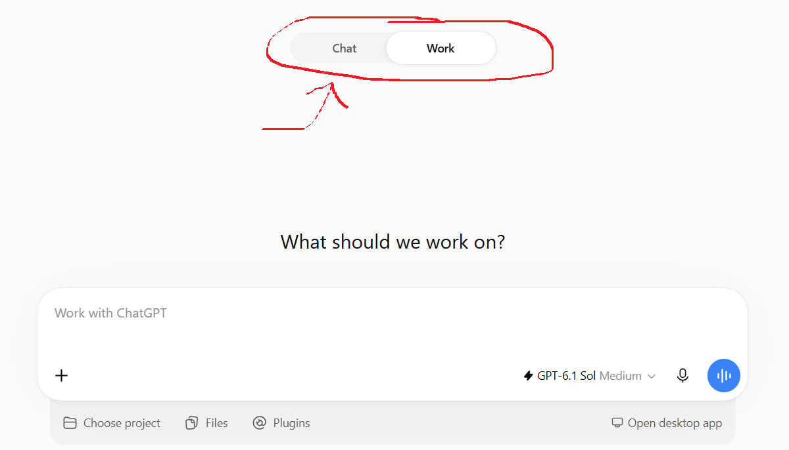<figcaption>La modalità Work: modello e livello di ragionamento in basso a destra, e sotto la scelta di progetto, file e plugin</figcaption></figure>

## 2. Modelli e livelli di ragionamento: la cosa più importante

È la cosa che fa più differenza, ed è quella che quasi nessuno tocca. Accanto alla casella di testo c'è un selettore del **livello di ragionamento** (*thinking effort*). In **Chat** ha quattro posizioni: **Instant**, **Medium**, **High**, **Pro**.

::: {.columns}
::: {.column width="50%"}
<figure>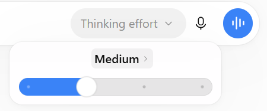<figcaption>Livello *Medium* (il default)</figcaption></figure>
:::
::: {.column width="50%"}
<figure>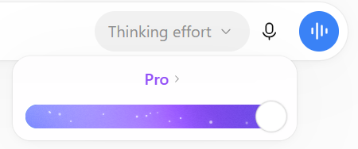<figcaption>Livello *Pro*, all'estremo destro</figcaption></figure>
:::
:::

Cliccando sul nome del livello si apre anche la scelta del **modello**: di solito conviene lasciare il più recente.

<figure>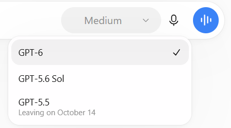<figcaption>La scelta del modello in Chat. I modelli più vecchi vengono ritirati con preavviso</figcaption></figure>

Indicativamente:

| Livello | Quando usarlo |
|---|---|
| **Instant** | Domande banali, riformulazioni veloci, traduzioni semplici. |
| **Medium** | Il default: va bene per la maggior parte delle richieste. |
| **High** | Statistica, codice, revisione critica di un testo o di un articolo, ragionamenti delicati. Nel dubbio, questo. |
| **Pro** | Problemi davvero difficili o lavori articolati da sviluppare dall'inizio alla fine. Lento e contingentato (vedi sotto). |

In **Work** valgono gli stessi modelli e gli stessi livelli di ragionamento di Codex, fino a *Extra high*, *Max* e *Ultra* (che consumano i limiti molto in fretta): vedi la <a href="../agenti-cli/codex.html#scegliere-modello-e-livello-di-ragionamento">guida a Codex</a>.

<figure>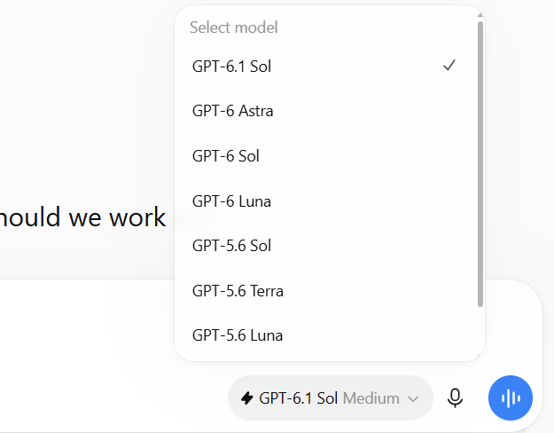<figcaption>In Work si sceglie tra i modelli di Codex</figcaption></figure>

> *Nota.* Nomi dei modelli, livelli disponibili e limiti sono quelli di ottobre 2026 e cambieranno, probabilmente anche in fretta. La logica, verosimilmente, resterà la stessa: un modello più recente e un ragionamento più alto danno risposte migliori, ma sono più lenti e consumano di più.

## 3. I limiti d'uso: in Chat, tranquilli (tranne con Pro)

Una rassicurazione, che spero incoraggi a osare di più: nella mia esperienza con ChatGPT Edu, la **Chat** anche con moltissimi prompt ripetuti a ragionamento **High** **non ha mai raggiunto limiti di utilizzo**. Usate High senza troppi scrupoli.

Diverso è il caso di **Work**, che attinge ai limiti di Codex (finestra di 5 ore e settimanale), e soprattutto di **Pro**: lì i limiti ci sono e si sentono (in un certo periodo erano appena **16 richieste al mese**; non so se con Edu sia ancora così). Pro ha senso per sviluppare progetti molto articolati dall'inizio alla fine, ma per quello, francamente, è preferibile **Codex**.

## 4. Strumenti: ricerca web e Deep research

Il pulsante **+** a sinistra della casella apre gli strumenti: caricare file, generare immagini, ricerca web, **Deep research** e altro.

<figure>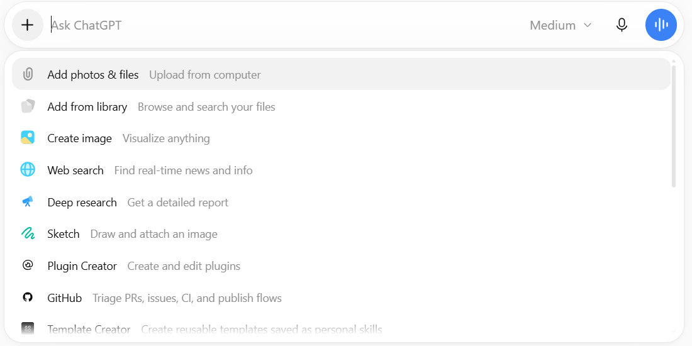<figcaption>Il menu **+**: file, immagini, ricerca web, Deep research, plugin</figcaption></figure>

- **Web search**: risposte basate su fonti aggiornate, con link. Utile per qualsiasi cosa successa di recente o per verificare.
- **Deep research**: ChatGPT lavora per diversi minuti, consulta decine di fonti e restituisce un **report strutturato con citazioni**. Va bene per una ricognizione su un tema, un confronto tra strumenti o metodi, una prima mappa della letteratura. Prima di partire di solito pone qualche domanda per chiarire cosa vi serve: rispondete con cura, perché da lì dipende il risultato. Le fonti vanno sempre controllate, soprattutto quelle scientifiche.

## 5. Connettori: Gmail, Calendar, GitHub, Drive...

Questa è la funzione che più spesso viene ignorata, ed è tra le più utili. Scrivendo **@** nella casella di testo compaiono i **connettori** (qui chiamati *plugin*) e le eventuali skill: Gmail, Google Calendar, Google Drive, GitHub, e altri. Una volta collegato un account, ChatGPT può leggere (e, se glielo chiedete, agire) direttamente lì.

<figure>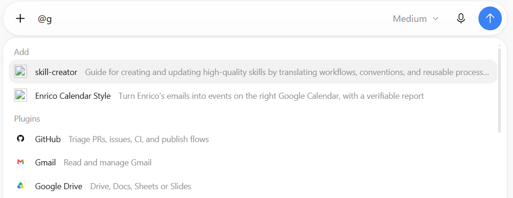<figcaption>Digitando **@** compaiono skill e plugin collegati (qui filtrati con la lettera "g")</figcaption></figure>

I connettori si installano e si gestiscono dalla pagina **Plugins** (icona **@** nella barra a sinistra). La scheda *Università di Padova* raccoglierebbe quelli resi disponibili dall'ateneo; al momento è vuota.

<figure>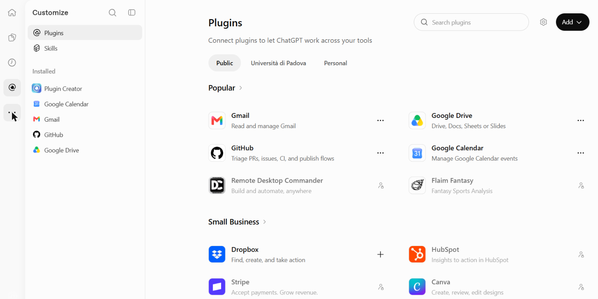<figcaption>La pagina Plugins: a sinistra quelli installati, a destra il catalogo</figcaption></figure>

Qualche esempio di richieste:

- *@Gmail riassumimi le mail della settimana che richiedono una mia risposta, in ordine di urgenza.*
- *@Gmail trova le mail sul progetto X degli ultimi tre mesi e ricostruiscimi cosa abbiamo deciso.*
- *@Google Calendar quando ho due ore libere la prossima settimana per una riunione?*
- *@GitHub cosa è cambiato nella repository Y nell'ultimo mese?*
- *@Google Drive cerca il documento con la bozza del progetto e dimmi cosa manca.*

Nella pagina iniziale ChatGPT propone anche, da solo, suggerimenti basati sulle mail recenti (tipo "X chiede una tesi: valuta e rispondi"). Due cautele: controllate sempre prima che invii o modifichi qualcosa, e ricordate che quello che legge passa dai server di OpenAI (attenzione ai dati sensibili).

## 6. Progetti: contesto e fonti che restano

Un **progetto** (nella barra laterale, *Projects* → **+**) raccoglie in un posto le conversazioni su un tema, le **fonti** (*Sources*) e le **istruzioni** valide per tutte le chat del progetto. Molti (me compreso, lo confesso) usano i progetti solo come cartelle per tenere in ordine le chat. Il loro valore vero sta in fonti e istruzioni, che sono le due cose da riempire.

<figure>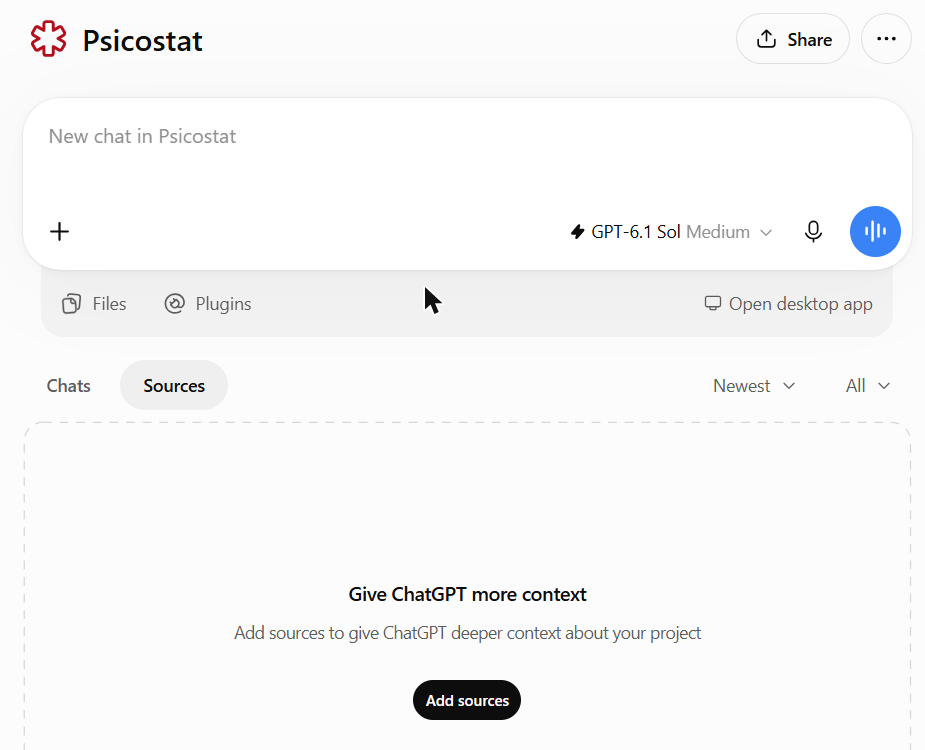<figcaption>La pagina di un progetto, con le schede *Chats* e *Sources*. Qui le fonti sono ancora vuote: un'occasione sprecata</figcaption></figure>

Le **fonti** si aggiungono con *Add sources*: file caricati dal computer, file già presenti nel vostro spazio ChatGPT (*Space*), testo incollato, documenti da Google Drive (Slack è disattivato).

<figure>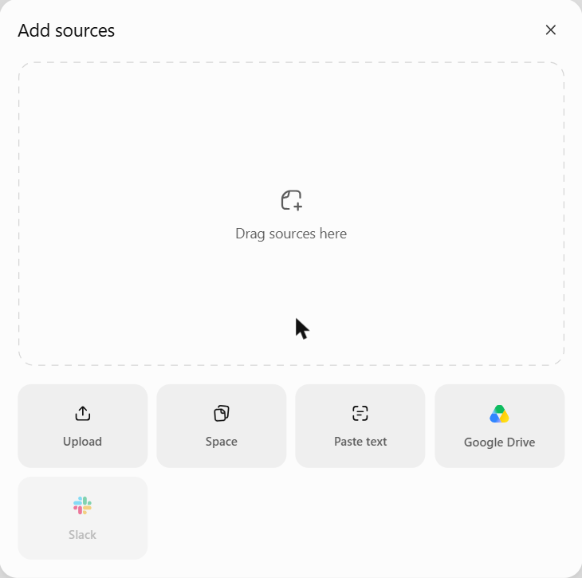<figcaption>Le possibili fonti di un progetto</figcaption></figure>

Le **istruzioni** si scrivono in *Project settings* (menu **⋯** in alto a destra). Lì si decide anche se il progetto condivide la **memoria** con le altre chat o ne ha una propria, separata (utile per non "contaminare" un progetto con il resto).

<figure>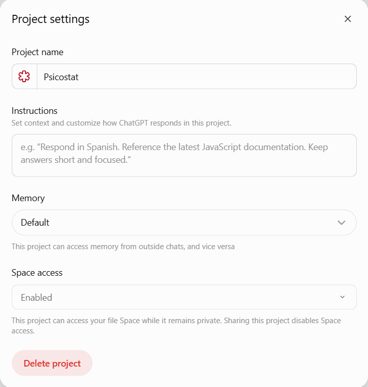<figcaption>*Project settings*: nome, istruzioni, memoria, accesso allo Space</figcaption></figure>

Esempi d'uso: un progetto per la **revisione di un articolo** (con il manoscritto e le linee guida della rivista come fonti, e nelle istruzioni il tipo di revisione che volete), uno per la **gestione degli studenti** di tesi (con regolamento e scadenze come fonti, e istruzioni su tono e procedure), uno per un **corso** (con programma, slide e domande d'esame). Non dovete rispiegare il contesto ogni volta.

Anche qui, però: per cose davvero complesse, con molti file che dipendono l'uno dall'altro (analisi, codice, report, siti), **Codex è più adatto**.

## 7. Codex: la bomba atomica

ChatGPT Edu include **Codex**, l'agente che lavora direttamente sui file del vostro computer: legge una cartella di progetto, scrive ed esegue codice, controlla gli errori, corregge, e vi dice cosa ha fatto. Per sviluppare **progetti, analisi, software, siti web**, praticamente qualsiasi cosa, è un salto di livello rispetto alla chat. Ed è il motivo principale per cui conviene non sprecare il credito Work.

Ne ho parlato estesamente qui:

- → <a href="../agenti-cli/index.html">**Agenti AI in locale**</a>: cosa cambia rispetto alla chat, con esempi di progetti reali;
- → <a href="../agenti-cli/codex.html">**Guida rapida a Codex**</a>: installazione, primo progetto, modelli, ragionamento, limiti, permessi (con un account Edu), da terminale;
- → <a href="../agenti-cli/app-desktop.html">**Guida alle app desktop**</a>: lo stesso lavoro dall'app ChatGPT (sezione *Codex*), senza terminale.

## In sintesi

- **Chat** per tutto l'ordinario; **Work** e soprattutto **Codex** per i progetti.
- **Alzate il ragionamento**: *High* è quasi sempre una buona scelta, e in Chat i limiti non si raggiungono (nella mia esperienza). *Pro* solo quando serve davvero.
- Provate **Deep research**, i **connettori** con **@** e i **progetti** (con fonti e istruzioni).
- Tutto quello che viene prodotto va **letto e verificato**: resta vostra responsabilità.

## Per andare oltre: skill, attività pianificate, agenti

Le cose sopra sono quelle fondamentali. Queste sono funzioni ulteriori, meno conosciute, che vale la pena provare una volta presa confidenza.

**Skill.** Sono file di istruzioni riutilizzabili su *come* fare certe cose: come scrivo il codice, come imposto un report, come scrivo una email, come inserisco gli impegni nel calendario. Si caricano dalla pagina *Skills* (icona **@** → *Skills*) e ChatGPT le usa quando servono, oppure le richiamate con **@**. Sono le stesse che si usano con Codex e Claude Code: scritte una volta, valgono ovunque.

Per me sono il modo migliore per **personalizzare** davvero ChatGPT, Codex e gli agenti in generale. Invece di ripetere ogni volta "scrivi il codice R così", "nei report fai così", "nelle email usa questo tono", lo scrivete una volta sola e con cura. Da lì in poi i risultati vi somigliano molto di più. Il formato è uno standard aperto (un file `SKILL.md` in una cartella), quindi le skill non vi legano a un fornitore. Ne parlo in dettaglio nel <a href="../skills/index.html">post dedicato alle skill</a>. Le mie sono pubbliche <a href="https://github.com/EnricoToffalini/ai-skills" target="_blank">qui</a>, e potete usarle come modello per le vostre (c'è anche una skill, *skill-creator*, che aiuta a scriverle).

<figure>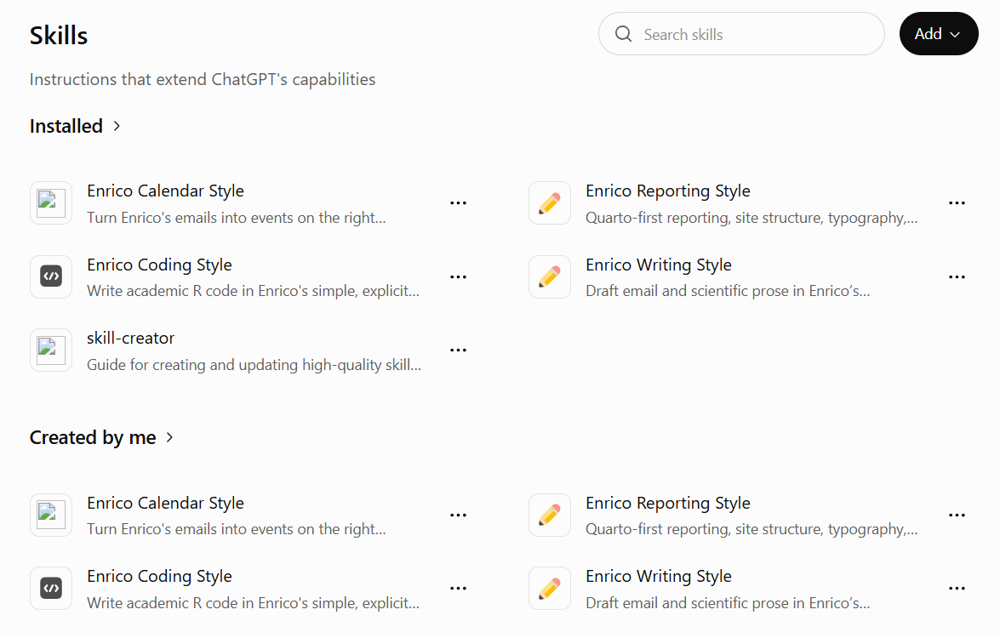<figcaption>Le mie skill caricate in ChatGPT Edu</figcaption></figure>

**Attività pianificate** (*Scheduled*, l'icona dell'orologio). ChatGPT esegue una richiesta a intervalli regolari e vi avvisa del risultato. Combinate con i connettori sono molto potenti: ogni mattina *"@Gmail guarda le mail arrivate da ieri e dimmi cosa richiede una mia risposta o contiene una scadenza"*; ogni lunedì *"@Google Calendar riassumimi gli impegni della settimana e segnala sovrapposizioni"*; ogni mese una ricerca sulle nuove pubblicazioni su un tema.

<figure>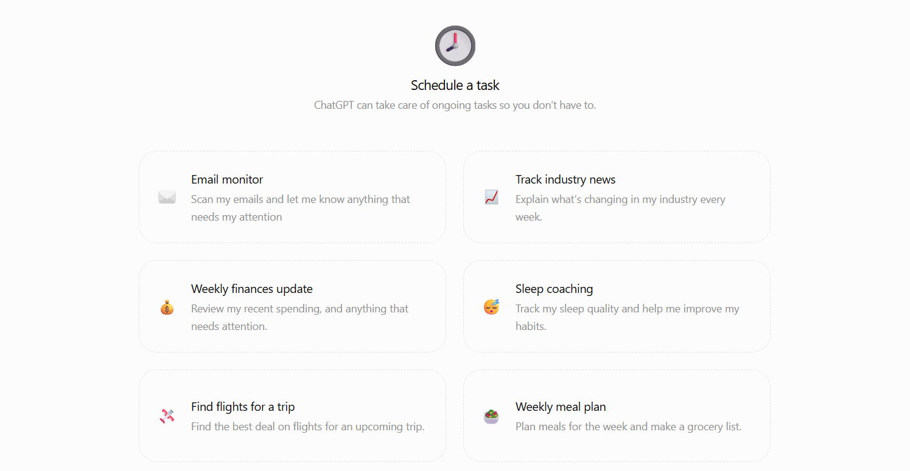<figcaption>La pagina delle attività pianificate, con alcuni esempi proposti (non tutti di interesse accademico...)</figcaption></figure>

**Agenti** (menu **⋯** nella barra a sinistra → *Agents*). Si possono costruire agenti che svolgono un compito ricorrente con istruzioni, fonti e connettori propri, e condividerli con i colleghi nella *directory* dell'Università di Padova. Ad esempio, un agente che gestisce le richieste degli studenti seguendo regolamento e procedure del corso di studi.

<figure>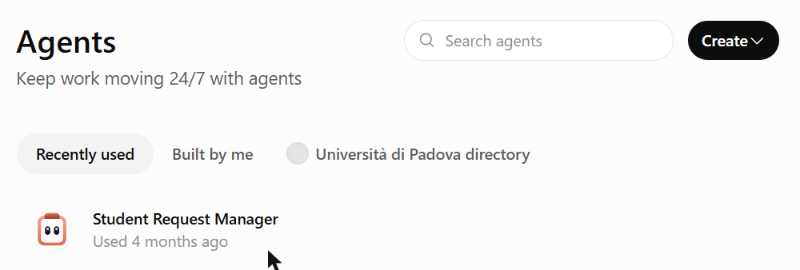<figcaption>La pagina degli agenti, con la directory di ateneo</figcaption></figure>

::: {.callout-note appearance="simple" icon="false"}
**Chi ha scritto questo post.** Di fatto, l'ha scritto **Claude** (Anthropic), lavorando come agente in Claude Code. Io ho fornito i materiali, l'esperienza e le indicazioni, e ho supervisionato e rivisto il risultato. La prima persona nel testo resta la mia, perché esperienze e opinioni sono mie. Lo dico per onestà, ma anche perché è un esempio concreto di quello che questa serie racconta: un agente AI, personalizzato con le mie skill (vedi il <a href="../skills/index.html">post sulle skill</a>), può svolgere gran parte di un lavoro come questo, purché riceva buone indicazioni e qualcuno controlli quello che fa.
:::
