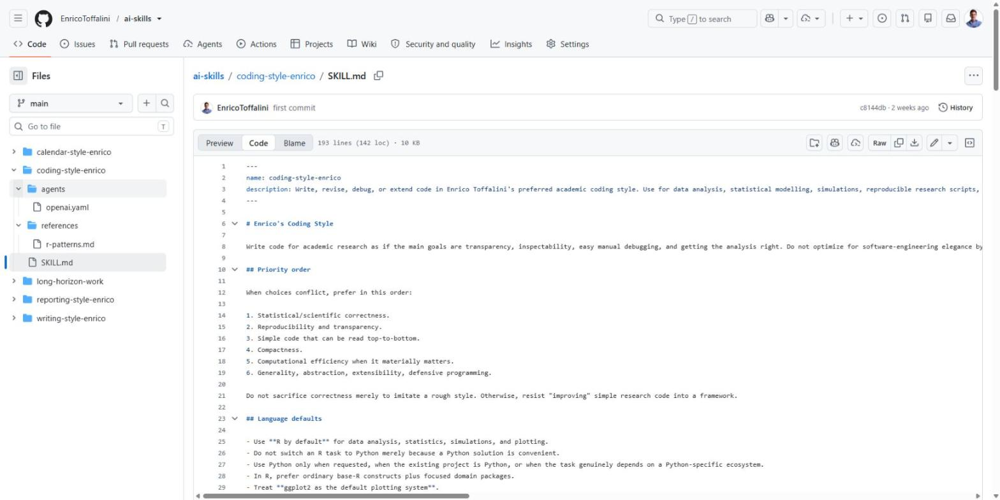
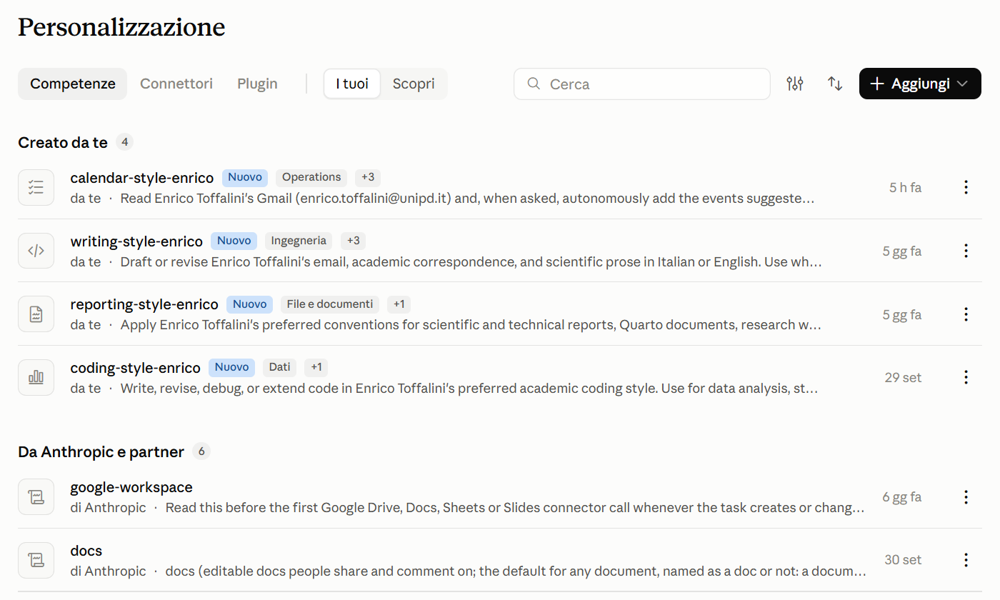

Questo è il terzo post di una piccola serie. Nel primo ho parlato degli <a href="../agenti-cli/index.html">**agenti AI in locale**</a> (Claude Code e Codex, da terminale o da app desktop), nel secondo di <a href="../gpt-edu/index.html">**ChatGPT Edu**</a>. In entrambi ho accennato alle **skill**, rimandando a un post dedicato. Eccolo.

Partiamo da un'esperienza comune. Chiedete all'AI uno script R, e quello se ne esce con cinque pacchetti tidyverse anche se a voi tidyverse non è mai piaciuto e non l'avreste usato. Chiedete un report, e lui vi produce un html o un pdf pure bellissimo, ma l'editabile è in un formato sconosciuto mentre voi l'avreste voluto in Quarto ma vi siete dimenticati di specificarlo. Chiedete di abbozzare una email per comunicare cordialmente un singolo punto breve e conciso e quello inizia con tre righe di convenevoli che voi non scrivereste mai. Si corregge... ma la volta dopo si ricomincia da capo. Il modello non è sbagliato: produce la risposta "media", ma non quella che fa per voi. Ma chi fa ricerca, comunque, lavora quasi sempre con **convenzioni precise**: sul codice, sulla scrittura, sul reporting, su certe analisi, su certe procedure. E oltre a questo, ciascuno di noi ha le proprie personalissime convenzioni, alle quali non vuole rinunciare. Le skill offrono uno strumento abbastanza semplice per "insegnarle" al vostro AI una volta per tutte.

> **In breve.** Una skill è un file di istruzioni (più eventuali materiali di supporto) che descrive *come* svolgere un certo tipo di compito. L'AI la carica da sola quando il compito lo richiede. Funziona allo stesso modo in chat e negli agenti in locale, con Claude e con ChatGPT/Codex.


## 1. Cos'è una skill

Tecnicamente, una skill è una **cartella** che contiene un file `SKILL.md`. Il file ha una breve intestazione con **nome** e **descrizione**, seguita da istruzioni in testo libero (Markdown). Accanto possono esserci altri file: documenti di riferimento più dettagliati (`references/`), modelli, script, esempi.

<figure><figcaption>Una delle mie skill su GitHub: a sinistra la cartella con `SKILL.md` e i materiali di supporto, a destra l'inizio del file, con nome, descrizione e le prime regole</figcaption></figure>

Il meccanismo che rende le skill utili è il **caricamento progressivo**:

1. all'inizio di ogni conversazione l'AI vede solo **nome e descrizione** di tutte le skill disponibili (poche righe ciascuna);
2. quando una richiesta corrisponde alla descrizione, legge il `SKILL.md` completo;
3. i file di riferimento li apre solo se servono per quel compito specifico.

Questo significa che si possono avere molte skill, anche lunghe, senza appesantire ogni conversazione. E significa che la **descrizione** è la parte più importante: è quella che decide se la skill verrà usata.

Il formato è uno <a href="https://agentskills.io" target="_blank">standard aperto</a>, nato da Anthropic e adottato anche da OpenAI e da altri strumenti. In pratica, la stessa cartella funziona in Claude (chat e Claude Code) e in ChatGPT (chat e Codex). Le skill sono file di testo vostri: non vi legano a un fornitore, si possono tenere sotto Git, condividere, migliorare nel tempo.


## 2. Skill, istruzioni, progetti, memoria: cosa cambia

Esistono già altri modi per personalizzare l'AI. Le skill non li sostituiscono, ma coprono un caso che gli altri coprono male.

| Strumento | Vale per | Limite |
|---|---|---|
| **Istruzioni personalizzate** (nelle impostazioni) | tutte le conversazioni | devono restare brevi e generiche; sono sempre attive, anche quando non servono |
| **Istruzioni di progetto** (progetti in chat, `CLAUDE.md`, `AGENTS.md`) | un progetto | vanno riscritte o copiate per ogni progetto |
| **Memoria** automatica | tutte le conversazioni | decide l'AI cosa ricordare; poco controllabile e poco precisa |
| **Skill** | un *tipo di compito*, in qualsiasi progetto | vanno scritte con cura (vedi sotto) |

La differenza chiave è che una skill è legata a **cosa** si sta facendo, non a **dove**. La skill sul codice R si attiva quando si scrive codice R, in qualsiasi progetto e con qualsiasi strumento. Quella sulle email si attiva quando si scrive una email. Le altre restano dormienti.


## 3. Perché sono così utili in ambito accademico

Chi fa ricerca accumula convenzioni, spesso senza accorgersene. Qualche esempio, dal mio caso ma credo generalizzabile:

- **Codice**: R di default, Python dove necessario; R base più pacchetti mirati, `ggplot2` per i grafici ma non il resto del tidyverse (a me non piace molto, ma qualche funzione è davvero utile); nomi brevi e ordinari per gli oggetti, con certe convenzioni ricorrenti; codice che si legge dall'alto in basso senza astrazioni inutili; poco wrapping dentro funzioni; modifiche chirurgiche al codice esistente (non è come lo farebbe un ingegnere, ma è come lo farei io). 
- **Reporting**: Quarto come scelta predefinita per report, siti, materiali supplementari; certe convenzioni grafiche; tabelle che non si accavallano; struttura delle cartelle semplice. 
- **Scrittura**: registro diverso per revisione email a colleghi, collaboratori, amici, studenti, editor; per aiuto nella prosa scientifica sempre frasi brevi, niente enfasi, cautela specifica e non generica, certe formule da preferire, altre da evitare. 
- **Procedure operative specifiche**: quale calendario usare per quale tipo di impegno (con i relativi identificativi), come nominare gli eventi, cosa l'AI può fare anche da sola e cosa deve solo proporre.

Ciascuna di queste cose, presa da sola, è banale. Il problema è che sono decine, e ripeterle a ogni richiesta diventa fastidioso Senza skill si finisce per accettare di default la risposta "media" o correggerla a mano ogni volta. Con le skill succedono tre cose:

- **si accelera**: meno correzioni, meno spiegazioni, meno avanti e indietro; 
- **si personalizza**: i risultati assomigliano a quello che avreste fatto voi; 
- **si standardizza**: progetti diversi, fatti a mesi di distanza o con strumenti diversi, seguono le stesse convenzioni. Questo vale ancora di più se le skill sono condivise in un gruppo di ricerca. 

Le mie skill sono pubbliche <a href="https://github.com/EnricoToffalini/ai-skills" target="_blank">qui</a>. Dato che sono personali (alcune personalissime, come quelle con gli ID dei calendar) non vanno copiate così come sono, ma possono servire da base


## 4. Oltre lo stile: condensare un'expertise

Prima ho parlato di preferenze. Ma l'uso più interessante delle skill secondo me è un altro: **mettere per iscritto una competenza**, in modo che l'AI la applichi in modo coerente.

Molta della conoscenza di un ricercatore è tacita: come si fa *davvero* una certa analisi quando si è davvero esperti, quali controlli non vanno mai saltati e quali magari consideriamo secondari, quali errori fanno tipicamente gli studenti, quali scelte sono difendibili e quali no. Una skill obbliga a esplicitarla, e una volta esplicitata diventa riutilizzabile, e anzi più che riutilizzabile: per il vostro AI diventa il default. Qualche esempio di skill che un ricercatore o un gruppo potrebbe scrivere:

- **una pipeline di analisi**: ad esempio analisi fattoriale confermativa e invarianza di misura, con le scelte di stima appropriate al tipo di dati, i controlli da fare, gli indici da riportare e come interpretarli;
- **simulazioni per l'analisi della potenza**, secondo un certo schema (parametri espliciti, numero di iterazioni, come riportare l'incertezza);
- **lo scoring di uno strumento**: come calcolare i punteggi di un test, come gestire i dati mancanti, come convertirli in punteggi standardizzati secondo le norme;
- **meta-analisi**: dalla codifica degli studi al calcolo degli effect size, al modello, ai grafici e al diagramma di flusso;
- **revisione di manoscritti** secondo una checklist (es. standard di reporting della propria disciplina), con un formato fisso per i commenti;
- **materiali didattici**: domande d'esame con un certo formato e livello di difficoltà, quiz importabili su Moodle, esercizi con soluzione commentata;
- **procedure del corso di studi o del dipartimento**: tesi, tirocini, richieste ricorrenti degli studenti, con i riferimenti al regolamento.

Un gruppo di ricerca potrebbe tenere le proprie skill in una repository comune: una specie di **manuale di laboratorio** che però, oltre a essere letto dalle persone, viene applicato dall'AI. Un dottorando nuovo che usa un agente con quelle skill lavora da subito secondo le convenzioni del gruppo.

Due cautele. Una skill **non trasforma il modello in un esperto**: gli trasmette quello che sapete voi, né più né meno. Se la competenza descritta è approssimativa, l'AI applicherà con grande coerenza una procedura approssimativa. E il risultato va comunque **controllato**: le skill riducono gli errori di stile e di procedura, non vi esonerano dal verificare l'analisi.

Per dare un'idea concreta, questo è uno scheletro (semplificato) di una skill del primo tipo:

```markdown
---
name: cfa-lavaan
description: Run and report confirmatory factor analysis and measurement
  invariance in R with lavaan. Use when the user asks to fit, compare, or
  report CFA models, test invariance across groups, or check the factor
  structure of a questionnaire.
---

# CFA with lavaan

## Before fitting
- Inspect item distributions and missing data; report both.
- Ordinal items with few categories (< 5): use WLSMV with ordered = TRUE.
  Otherwise use MLR and FIML for missing data.

## Fitting and reporting
- Report chi-square, CFI, TLI, RMSEA with 90% CI, SRMR.
- Do not treat fit cutoffs as rigid pass/fail rules; discuss local misfit
  (residual correlations, modification indices) before changing the model.
- Never add residual covariances only to improve fit without a substantive
  justification; state each one explicitly.

## Invariance
- Test configural, metric, scalar models in this order. ...

For reporting tables and wording, read references/reporting.md.
```

La descrizione dice **cosa** fa e **quando** usarla. Il corpo contiene regole concrete, comprese quelle su cosa *non* fare. I dettagli più lunghi stanno in un file a parte, letto solo se serve.


## 5. Dove si usano: chat e agenti

Le skill funzionano sia nelle interfacce in chat sia negli agenti in locale. Cambia solo dove le si carica.

**Claude, in chat (web e app desktop).** Si caricano da *Personalizzazione* → *Competenze* (in inglese *Customize* → *Skills*), con il pulsante *Aggiungi*. Lì compaiono anche le skill fornite da Anthropic (documenti Word, PDF, presentazioni, ecc.), che si possono attivare o disattivare.

<figure><figcaption>Le skill in Claude: in alto quelle create da me, sotto quelle fornite da Anthropic</figcaption></figure>

**ChatGPT, in chat.** Si caricano dalla pagina *Skills*, e si possono richiamare anche esplicitamente con **@** (vedi il <a href="../gpt-edu/index.html">post su ChatGPT Edu</a>).

<figure><figcaption>Le stesse skill caricate in ChatGPT Edu</figcaption></figure>

**Claude Code e Codex, da terminale o da app desktop.** Basta mettere le cartelle delle skill in una posizione nota: `~/.claude/skills/` per Claude Code e `~/.codex/skills/` per Codex (dove `~` è la vostra cartella utente). Così valgono per tutti i progetti. Si possono anche mettere dentro un singolo progetto (ad esempio in `.claude/skills/`), se riguardano solo quello: in questo caso viaggiano con la repository e le trova chiunque ci lavori. Le stesse cartelle valgono per le app desktop: nella <a href="../agenti-cli/app-desktop.html">guida alle app</a> si vede l'app Codex che legge la mia skill sui report da `~/.codex/skills/`, come da terminale. In Claude Code il comando `/skills` mostra quelle disponibili, e una skill si può richiamare esplicitamente con `/nome-della-skill`.

Nella pratica, la maggior parte delle volte non serve richiamarle: l'agente le riconosce da solo. Nella <a href="../agenti-cli/codex.html">guida a Codex</a>, ad esempio, avevo chiesto soltanto di trasformare un'analisi in un report Quarto. Codex, prima di proporre il piano, è andato a leggersi la mia skill sui report:

<figure><figcaption>Codex legge da solo `reporting-style-enrico/SKILL.md` (riga *Ran Get-Content ...*) prima di pianificare il report</figcaption></figure>

Negli agenti in locale le skill rendono di più, perché l'agente può anche **eseguire** quello che la skill descrive: lanciare gli script di supporto, renderizzare il documento, controllare il risultato rispetto a una checklist.

Un dettaglio pratico: se volete usare la stessa skill in ambienti diversi, scrivetela in modo **indipendente dallo strumento**. Ad esempio, invece di "usa lo strumento X per leggere la mail", "leggi la mail con gli strumenti disponibili". Dove le differenze sono inevitabili (i connettori hanno nomi e opzioni diversi in Claude e in ChatGPT), basta una breve sezione che le elenca.


## 6. Come scriverne una

Qualche indicazione, frutto più di errori che di teoria.

- **Partite da una frustrazione ricorrente.** Se avete corretto la stessa cosa tre volte, è materiale per una skill. Non serve partire con un documento completo.
- **Curate la descrizione.** Deve dire cosa fa la skill e **quando** usarla, con le parole che usereste nelle richieste. Una descrizione vaga produce una skill che non si attiva, o che si attiva a sproposito.
- **Siate concreti e prescrittivi.** "Scrivi codice chiaro" non serve a niente: il modello pensa già di farlo. "Usa `=` per l'assegnazione", "non usare `dplyr` se non è già nel progetto", "nelle email agli studenti metti prima la valutazione complessiva, poi la correzione principale" funzionano.
- **Date un ordine di priorità.** Quando due regole sono in conflitto (ad esempio compattezza contro leggibilità), l'AI deve sapere quale prevale.
- **Dite anche cosa *non* fare.** Sono spesso le regole più utili, soprattutto nelle skill che compiono azioni (es. "non cancellare mai eventi", "non creare file di pianificazione nel progetto senza chiedere").
- **Tenete corto il `SKILL.md`.** Spostate i dettagli in file di riferimento separati e indicate quando leggerli.
- **Una skill per ambito.** Meglio skill separate per scrittura, codice e reporting, che si combinano, che una sola skill enorme con tutto dentro.
- **Fatevi aiutare dall'AI.** Esiste una skill apposita, *skill-creator* (disponibile in Claude), che guida nella scrittura. In alternativa: date a un agente una cartella con il vostro codice, o una serie di vostre email, e chiedetegli di ricavarne le convenzioni; oppure chiedetegli di intervistarvi. Poi rileggete e correggete a mano: la prima bozza tende a essere generica.
- **Usatele e rivedetele.** Ogni volta che l'AI sbaglia qualcosa nonostante la skill, chiedetevi se la regola mancava o era scritta male. Tenetele sotto Git: è utile vedere come cambiano.


## 7. Precauzioni

- **Una skill non è una garanzia.** Il modello può ignorarla, applicarla male, o non riconoscere che serve. Se una skill è importante per un compito, richiamatela esplicitamente.
- **Le skill altrui vanno lette prima di installarle.** Una skill contiene istruzioni, e a volte script, che l'AI eseguirà con i vostri permessi. Usate solo skill di fonti affidabili, e leggetele.
- **Niente password o token nelle skill**, soprattutto se le condividete.
- **Meno è meglio.** Molte skill sovrapposte o contraddittorie confondono il modello. Ogni tanto conviene fare pulizia.
- **La responsabilità resta vostra**, come sempre: la skill decide come viene fatto un lavoro, non se è giusto.


## In sintesi

- Le skill sono cartelle con un file `SKILL.md`: nome, descrizione e istruzioni su **come** fare un certo tipo di compito.
- L'AI le carica da sola quando servono; funzionano in chat e negli agenti in locale (da terminale o app), con Claude e con ChatGPT/Codex.
- Servono a **personalizzare** (convenzioni di scrittura, codice, reporting, procedure) e a **condensare un'expertise** (pipeline di analisi, materiali, flussi di lavoro), rendendola riutilizzabile e condivisibile.
- Scrivetele partendo da problemi reali, con regole concrete e una descrizione precisa, e rivedetele nel tempo.

Le mie sono <a href="https://github.com/EnricoToffalini/ai-skills" target="_blank">qui</a>.


::: {.callout-note appearance="simple" icon="false"}
**Chi ha scritto questo post.** Di fatto, l'ha scritto **Claude** (Anthropic), lavorando come agente in Claude Code, e ha catturato anche parte delle schermate. Io ho fornito i materiali, l'esperienza e le indicazioni, e ho supervisionato e rivisto il risultato. La prima persona nel testo resta la mia, perché esperienze e opinioni sono mie. Lo dico per onestà, ma anche perché è un esempio concreto di quello che questa serie racconta: un agente AI, personalizzato con le mie skill, può svolgere gran parte di un lavoro come questo, purché riceva buone indicazioni e qualcuno controlli quello che fa.
:::
